# 101Engine Renderer設計資料
## 全体構成・設計判断・実装方針

作成日：2026年10月8日  
設計の基準：このチャットでの最終的な合意と、Notion「アーキテクチャ策定」に記録された、それと矛盾しない設計意図  
用途：実装計画の策定、実装時の詳細設計、自己学習、2026年11月の作品フィードバック会に向けた説明の準備  
文書の状態：基本設計の記録。実装済み仕様書、確定した作業日程、完成コードではない。

---

<a id="guide"></a>
## この資料の読み方

本書は、設計過程の発言を時系列に並べ直したものではない。本文には最終的に採用した構成を記載し、比較した案と採用理由を各章へ配置する。置き換えた案は付録Bへ分離した。具体的な保存型、APIの全引数、エラー処理など、合意していない内容は実装時の詳細設計へ残す。

### 記述の状態

| 表記 | 意味 |
|---|---|
| **採用した方針** | 設計者が明示した要件、採用した案、または後続の議論で前提となった方針 |
| **最終整理** | 議論の最後に整理した方向性。フィールドやアルゴリズムの細部まで確定したことを意味しない |
| **実装候補・説明用の例** | 方針を具体的に説明するための選択。本文への掲載だけで採用を確定しない |
| **詳細設計事項** | 実装時に判断する必要がある事項 |
| **確認項目** | 設計意図から整理した検証の観点。実施済みの試験結果ではない |

「設計者」はこのチャットの利用者を指す。設計者自身が述べた意図と、会話で説明された技術的な理由を区別する。理由が記録されていない選択に対し、推測で動機を付け足さない。

### 参照と確認範囲

- 会話の参照は、付録Aの**会話 C01～C24**に示す発言箇所へ対応する。一部の番号は先行の決定事項資料に合わせて欠番としている。
- Notionの参照は、付録Aの**記録 N01～N20**に示す見出しと記述へ対応する。
- 技術的な説明の一次資料は付録Dにまとめ、本文の該当箇所から参照する。外部資料は実現方法や制約の確認に用い、そこにある機能を101Engineの採用仕様へ自動的に追加しない。
- 本作成時に取得できたNotion本文は、取得結果に **2026年10月7日14:30:01 UTC** と記載された内容である。それ以降の編集まで含まれるとは扱わない。
- 旧Notionの埋め込みPNGの内部は、先行の照合作業で取得できていない。本書の図は会話と取得できた本文から作成し、そのPNGを確認・修正したとは扱わない。
- 本書作成ではGitHubの最新実装を再調査していない。既存機能については、会話中に行ったコード調査の記録を、対象コミットとともに第10・12章で参照する。

### 疑似コードの共通前提

疑似コードは、責務と情報の受け渡しを示すためのものである。本文で決定済みとしない型やメソッドは、説明のための名前であり、新しい実装要件ではない。

`Result<T>`は成功した値またはエラーを表し、`TRY(expression)`は成功値を取り出すか、失敗を呼び出し元へ返す記法とする。これは最終的なエラー型の指定ではない。本文のコード例は成否を返す形式に揃えるが、個別Objectの不適合をどの範囲へ伝播させるかは第13章に残す。

RenderListを扱う一連のコード例では、Notionにある候補に合わせて**インデックス配列**を使用する。これは保存形式の採用決定ではない。元のFrameRenderDataは、対応するGraphのCPU側コマンド記録が終了するまで同一内容で保持される前提を置く。

図はMermaid記法で記載する。Mermaid対応のMarkdown閲覧環境では図として表示できる。各図には、矢印が処理順、データの受け渡し、参照関係のどれを表すかを添える。

---

## 目次

**第Ⅰ部：目的と全体構成**

1. [再設計の目的と設計方針](#chapter-01)
2. [Renderer全体の構成と責務の境界](#chapter-02)
3. [Rendererの利用方法と1フレームの処理](#chapter-03)

**第Ⅱ部：描画入力からコマンド記録まで**

4. [描画入力：FrameRenderData・RenderView・RenderObject](#chapter-04)
5. [FrameRendererによる描画構成の作成](#chapter-05)
6. [RenderGraphによる使用宣言の解析と実行制御](#chapter-06)
7. [RenderObjectからDrawCommandへの変換と共通描画](#chapter-07)

**第Ⅲ部：描画を支えるリソース・Shader入力・DX12基盤**

8. [リソース管理とShader・Pipeline・Materialの分離](#chapter-08)
9. [Shader入力とMaterialパラメータの供給](#chapter-09)
10. [GPUデータ配置・寿命管理・DX12バックエンド](#chapter-10)
11. [編集・ホットリロード・情報公開](#chapter-11)

**第Ⅳ部：実装計画・詳細設計・検証への引き継ぎ**

12. [初期実装の範囲と既存実装からの移行](#chapter-12)
13. [詳細設計・動作確認・開発記録への引き継ぎ](#chapter-13)

**付録**

- [A. 設計判断の一覧と参照先](#appendix-a)
- [B. 変更・不採用・延期した案](#appendix-b)
- [C. 用語と疑似コードの読み方](#appendix-c)
- [D. 参考実装・技術資料](#appendix-d)

---

# 第Ⅰ部：目的と全体構成

<a id="chapter-01"></a>
## 1. 再設計の目的と設計方針

### 1.1 改善の目的

今回の再設計は、描画機能を個別に増やすだけの作業ではない。EngineのSceneやComponentから描画情報を受け取り、描画リソースの管理とパスの実行を行うRendererを、Engine固有の構造から分離する作業である。

設計者は当初から、FrameRenderDataの受け渡しをランタイムの中心に据え、Rendererの仕様にEngine側を接続する方針を示している。Notionにも、101Engine以外のシステムへ組み込める形を目指すと記している。これは独立性についての設計目標であり、他のEngineへの移植を実施済みであるという成果ではない。[会話 C01](#c01)、[記録 N01](#n01)

主な目的は次の三つである。

| 目的 | 今回の設計で行うこと | 実装後に確認すること |
|---|---|---|
| Engine固有仕様から描画処理を分離する | FrameRenderDataとリソースHandleを中心に公開境界を定める | Rendererの主要処理がActorや描画Componentの型を必要としないこと |
| 表現を追加・変更しやすくする | Shader・Pipeline・Materialを分け、パスの構築と共通描画を分離する | 新しい描画方式の追加で、共通処理に用途別の分岐を増やさずに済む範囲 |
| 表現を調整しながら開発できる基盤を作る | Shaderの再読み込み、Material値の更新、メタデータ取得を考慮する | 値やShaderの更新が、定めたタイミングで安全に描画へ反映されること |

NotionではShader・Materialの改善を **Various Expression**、ホットリロードを **Rapid Graphics Iteration** と関連づけている。本書では、前者を表現追加のしやすさ、後者を描画結果を確認しながら反復調整できることとして扱う。これらのコンセプト全体の定義を、取得した記述以上に補完しない。[記録 N04](#n04)、[記録 N05](#n05)

### 1.2 改善前の問題意識と、変更する責務

以下は、会話とNotionで挙げられた問題意識である。最新コードについて新しく検証した不具合一覧ではない。

| 問題意識 | 採用する整理 |
|---|---|
| App側がShadow、Scene、PostProcessなどの呼び出しを組み立てている | FrameRendererがRenderer内部で描画構成を作る |
| 描画Componentの種類と描画関数が強く対応している | RenderObjectとDrawCommandを介した共通経路を用意する |
| 個々の呼び出し順だけでは、リソース使用の整合性を検証しにくい | Usageを明示し、RenderGraphが登録順を検証する |
| 固定ShaderLibraryの選択が、Shader追加の入口になっている | コンパイル済みShaderをHandleで登録・参照する |
| ShaderやMaterialの変更と、その影響範囲が整理されていない | Revision、依存Pipeline、Material Layoutの更新を関係づける |
| GPUリソースの使用判断とDX12操作が複数箇所にある | 上位の使用判断とバックエンドの命令記録を分ける |

**登録順そのものを問題とするわけではない。** 最終方針では、構築者が指定した登録順を実行順として尊重する。改善対象は、その順序で使われるリソースの条件が明示・検証されていない点である。[会話 C19](#c19)、[記録 N08](#n08)

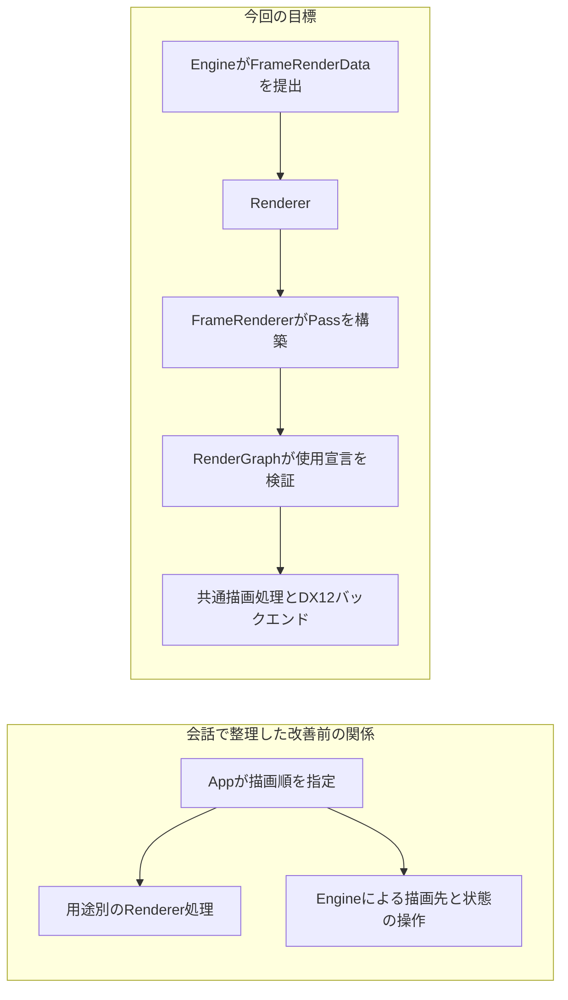

図1：矢印は呼び出し・制御の方向を表す。具体的な所有関係やクラス配置を確定する図ではない。

### 1.3 設計判断で優先する基準

| 基準 | 判断への適用 |
|---|---|
| Rendererの公開仕様を基準にする | Engine側がRenderer用データへ変換し、RendererをEngineの内部型へ合わせない |
| 共通処理と用途固有処理を分ける | パスの対象抽出と描画設定はパス構築側に置き、共通処理はその入力を処理する |
| 入力と処理の意味を明示する | Resource Usage、OutputLayout、Materialの名前・型・値などを区別する |
| 構築者の意図を勝手に変更しない | Passを並べ替えず、不適合を診断する |
| 拡張の余地と初期の実装量を分ける | MRTなどを考慮しても、Aliasingや並列記録まで一度に実装しない |
| 既存機能を活用する | DX12ラッパーを全面的に作り直すのではなく、責務と寿命管理を整理する |
| 詳細設計を必要な段階で行う | 保存型や全フィールドを、説明用の例から先に固定しない |

設計者は「これ以降の設計は各項目の実装時に詳細設計として考える」と明示した。Notionにも、機能単位の分割をそのままクラス化しないこと、細かく考えすぎて時間をかけすぎないことが記されている。本書はその方針を維持する。[会話 C22](#c22)、[記録 N02](#n02)

### 1.4 今回の範囲の概観

中心となるのは、FrameRenderData、Renderer管理のリソース、FrameRenderer、RenderPassBuilder、登録順で解析・実行するRenderGraph、共通RenderObjectとDrawCommand配列、Shader入力の整理、既存DX12基盤との接続である。

MRTは将来対応を前提とするが、今回の必須実装にはしない。Deferred Renderingは実現したい描画方式であり、本書の例にG-bufferが現れるだけで今回の実装タスクへ加えない。Aliasing、不要Pass除去、非同期Compute、複数Queue、並列コマンド記録、外部向けPass編集機能も、初期範囲とは区別する。詳細は[第12章](#chapter-12)にまとめる。

---

<a id="chapter-02"></a>
## 2. Renderer全体の構成と責務の境界

### 2.1 システム全体

Rendererは、公開API、描画リソース管理、描画構成の作成、使用宣言の検証、コマンド記録、GPUへの送信を含む全体の名称である。

本書では **RenderGraphシステム** を、FrameRenderer、RenderPass、機能としてのRenderGraph、およびそれらに接続する描画処理のまとまりとして用いる。機能としてのRenderGraphを総称と区別する必要がある箇所では、会話と同じく **RenderGraph Core** と表記する。説明上の呼び分けであり、その名前のクラスやモジュールを必ず作るという決定ではない。[会話 C15](#c15)

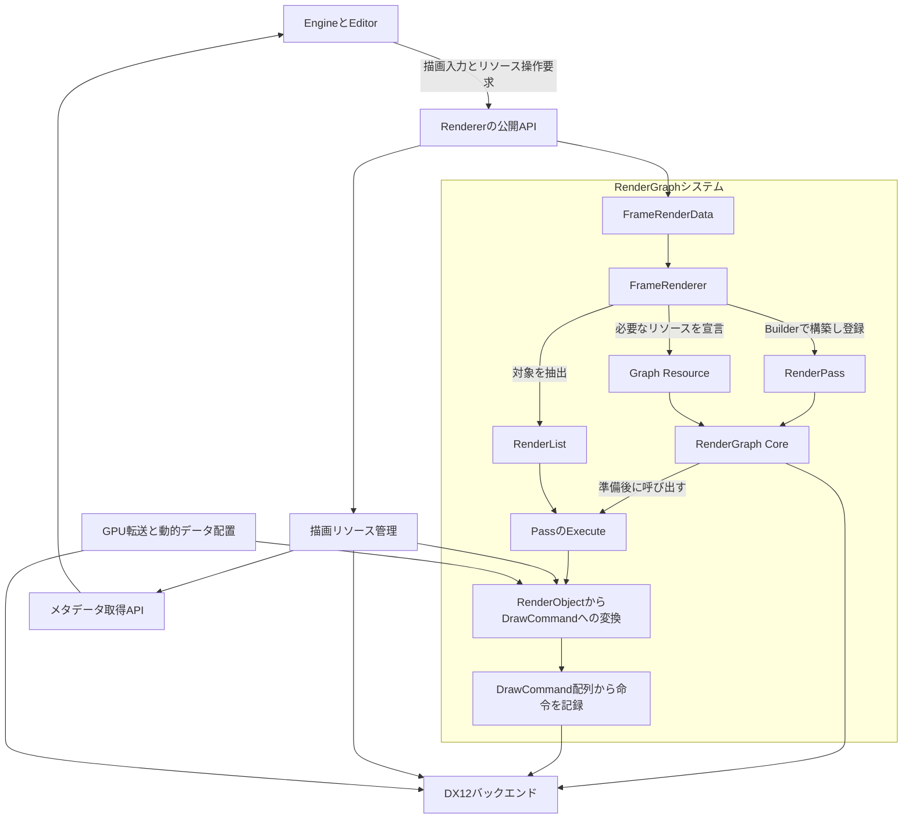

図2：矢印は主なデータの受け渡しと処理の利用関係を表す。すべてを単一の所有ツリーにする図ではない。

### 2.2 EngineとRendererの境界

| Engine・Editor側が担当すること | Renderer側が担当すること |
|---|---|
| Scene、Actor、Component、UIの論理構造を管理する | Renderer用の共通描画データを受け取る |
| AssetとRendererの登録APIを接続する | Shader、Pipeline、Material、Geometry、Textureなどを管理する |
| 各フレームの描画対象とView・Light情報を用意する | Viewやパスに必要な対象を抽出し、描画構成を作る |
| ユーザー操作をMaterial更新などのAPIへ変換する | 更新要求を受け取り、定めた時点で内部状態へ反映する |
| Inspectorやデバッグ画面の表示方法を決める | 必要なメタデータと診断情報を提供する |

Engine側の描画情報抽出は残る。RendererがScene全体を走査する方式へ置き換えるのではない。また、Engineが「表示する／しない」というゲーム上の判断を行うことまで禁止しない。Rendererが使う描画方式の分類・順序・カリング処理を、Engine固有型に依存せず扱うことが目的である。[会話 C01](#c01)、[記録 N03](#n03)、[記録 N07](#n07)

### 2.3 機能ごとの責務

| 機能 | 入力 | 主な出力 | 担当しないこと |
|---|---|---|---|
| FrameRenderer | FrameRenderData、描画設定、利用可能なリソース | RenderList、Graph Resource宣言、RenderPass | DX12バリアの直接判断を各パスへ重複記述すること |
| RenderGraph Core | 登録済みPassとResource Usage | 実行計画、診断、Executeの呼び出し | ShadowやBloomのアルゴリズムを名前から推測すること |
| RenderPass | 使用宣言とExecute | 呼び出された時の処理 | Graph全体の描画方式を管理すること |
| 共通描画変換 | RenderList、DrawSettings、リソース情報 | DrawCommand配列 | ShadowやUIという分類に基づく対象選別 |
| リソース管理 | 登録・更新・取得・破棄要求 | Handle、利用可能な実体、メタデータ | SceneのActorの寿命やInspectorの見た目を管理すること |
| GPU転送・動的データ配置 | バイト列、サイズ、利用条件 | GPU参照可能な領域と転送処理 | Materialパラメータの意味を決めること |
| DX12バックエンド | 上位が決定した操作 | DX12命令、送信、完了確認 | EngineのComponent分類や描画方式の採否を決めること |

FrameRendererが使うパス専用の構築関数や、PassのExecuteが、そのパス固有の事情を知ることは問題ではない。避けるのは、汎用的なGraph管理や共通描画変換に、用途ごとの固定分岐を持ち込むことである。関数が静的メソッドかどうかではなく、責務で区別する。[記録 N09](#n09)

### 2.4 公開する情報と、公開しない情報

| 通常の公開APIで扱う情報 | 通常の利用に要求しない情報 |
|---|---|
| Rendererが定義するFrameRenderData | Actor、Camera Componentなどの101Engine内部型 |
| Shader・MaterialなどのHandle | `ID3D12Resource*`、DX12のPSO実体 |
| 型・サイズ・状態などの読み取り用メタデータ | 生のGPU Descriptor Handle |
| Renderer形式のShader入力情報 | `ID3D12ShaderReflection*` |
| 明示的なパラメータ更新要求 | リソース本体への無制限な直接書き換え |

DX12を外部へ要求しないことは、初期化に描画先や表示面の情報を一切渡さないという意味ではない。その公開形式は詳細設計で定める。ウィンドウや出力画像の受け渡し方法を本書で新しく固定しない。

### 2.5 この分割を選んだ理由

設計者は、Rendererが外部の仕様へ合わせ続ける構造を避けたいと述べた。また、FrameRendererの具体的な描画構成が共通処理へ入り込むことを懸念している。公開境界をFrameRenderDataとリソースAPIに置き、内部では用途固有処理と汎用処理を分けることで、この二つの懸念を別々の境界で扱う。[会話 C01](#c01)、[会話 C11](#c11)、[記録 N01](#n01)、[記録 N09](#n09)

---

<a id="chapter-03"></a>
## 3. Rendererの利用方法と1フレームの処理

### 3.1 使用者向けの基本操作

基本APIは、`Initialize`、`SubmitFrameRenderData`、`Render`、`Finalize`を中心とする。リソースの登録・更新・取得は別のAPIとして提供する。FrameRenderDataは主要なフレーム入力であり、Rendererに対する唯一の入力ではない。[会話 C01](#c01)

```cpp
// 公開APIの関係を示す疑似コード。
// 引数型、初期化情報、登録結果の待ち方は詳細設計事項。
renderer.Initialize(rendererConfiguration);

ShaderHandle shader = renderer.RegisterShader(compiledShaderInput);
MaterialHandle material = renderer.RegisterMaterial(materialDescription);

while (applicationIsRunning)
{
    FrameRenderData frame = engine.BuildFrameRenderData();
    renderer.SubmitFrameRenderData(frame);
    renderer.Render();
}

renderer.Finalize();
```

この例の`RegisterShader`が返す時点で、必ずGPU描画に必要な準備まで完了しているとは決めていない。登録要求の受付、Handleの発行、内部での準備、描画可能性の確認をどう表すかは第8・13章で扱う。

### 3.2 一フレームの処理順

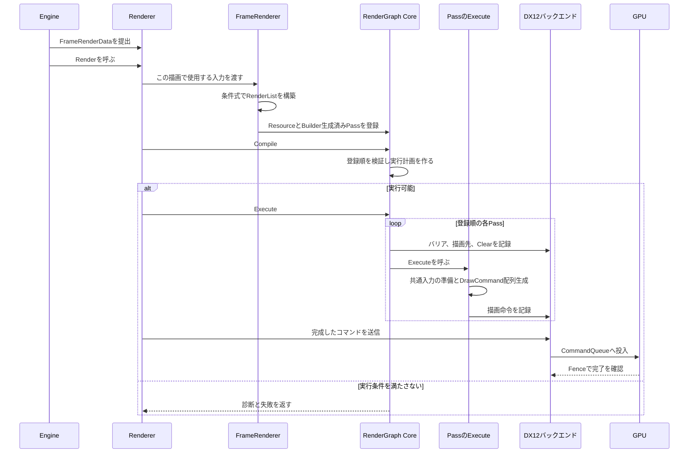

図3：矢印は処理の呼び出し順を示す。GPU処理はCPUの命令記録より後で行われるため、CPU関数の終了をGPU完了とみなさない。

### 3.3 Renderer内部の入口

```cpp
Result<void> Renderer::Render()
{
    // この呼び出しのCPU側コマンド記録完了まで、
    // 提出済み入力を同じ内容で参照できるようにする。
    // コピー、移動、共有のどれで実現するかは未決定。
    const FrameRenderData& frame = SubmittedFrameForThisRender();

    RenderGraph graph;
    TRY(m_frameRenderer.BuildFrameRenderPipeline(graph, frame));
    TRY(graph.Compile());

    auto recording = TRY(m_backend.BeginRecording());
    auto result = graph.Execute(recording.Context());

    if (!result)
    {
        // この例では未送信の記録を送らない。
        // 回復処理、画面の扱い、確保済み領域の回収は詳細設計事項。
        recording.DiscardUnsubmittedCommands();
        return result.Error();
    }

    TRY(m_backend.Submit(recording));
    return Success();
}
```

このコードは、成功したGraphを記録して送信する主経路を示す。表示対象へのPresent、複数Viewの外部出力、エラー時の代替表示まで完成したAPI例ではない。対応する出力先に必要な最後の操作を、バックエンドの表示処理へ接続する。

`graph.Compile()`はHLSLのコンパイルではない。Resource Usageからバリアや描画先設定を含む実行計画を作るCPU側の処理である。

### 3.4 登録要求を受ける時点と、実際に処理する時点

利用者が登録APIを随時呼べる一方、内部で実際に登録・転送・更新する時点はRendererが決める。これにより、利用側がGPUの状態を直接操作しなくて済む構成を目指す。[会話 C01](#c01)

ただし、「随時受け付ける」は「任意のスレッドから同時に呼べる」と同義ではない。要求をキューへ積む方法、引数データの所有、同じフレームへ反映する条件はまだ決まっていない。

### 3.5 この章で残す詳細設計事項

FrameRenderDataの取得方法、再Submit時の旧データの扱い、Renderer::Renderの再入を許すか、Graphの実行失敗後の回復、リソース更新の処理時点、終了時のGPU待機などを実装時に定める。疑似コードの関数名から、これらの条件が自動的に確定したとは扱わない。

---
# 第Ⅱ部：描画入力からコマンド記録まで

<a id="chapter-04"></a>
## 4. 描画入力：FrameRenderData・RenderView・RenderObject

### 4.1 FrameRenderDataは、この描画で使用する入力をまとめる

FrameRenderDataには、RenderObjectの集合、RenderView、Lightなどを含める。Engine側が必要な情報を抽出して提出し、Rendererは提出された形式を使って処理する。

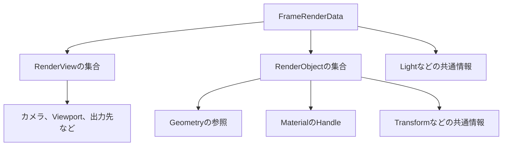

図4：矢印は概念上の包含・参照を表す。具体的な構造体の全フィールドやコンテナ型を指定しない。

FrameRenderDataに、描画方式固有の`opaque`、`transparent`、`shadow`といった完成済みリストを必須の構造として埋め込まない。RenderObjectの集合から、FrameRendererが必要な条件でリストを作る。[会話 C11](#c11)、[会話 C17](#c17)

### 4.2 RenderViewを独立して持つ理由

RenderViewは、カメラと描画対象範囲、出力先などを結び付けるための描画入力である。Camera Componentそのものではない。

設計者は複数Viewを扱う方針を採用し、NotionにはEditorのViewport、監視カメラとモニター、G-bufferのデバッグ表示を利用例として挙げている。これは想定用途であり、各機能の実装を今回すべて行うという指定ではない。[会話 C02](#c02)、[記録 N06](#n06)

| 場合 | Viewごとに異なり得る情報 |
|---|---|
| Game ViewとScene View | カメラ、Viewport、出力先、表示対象 |
| メインカメラと別のカメラ | 行列、解像度、出力画像 |
| World空間とScreen Space | 座標変換、表示範囲、必要な描画設定 |

同じフレーム内に複数のViewがあるため、View行列をフレーム全体で一つの値に固定しない。Light情報を共有できる場合でも、Shadow描画に使う行列とScene描画に使う行列は用途が異なる。

詳細設計では、Viewの識別方法、出力先Handle、View間で共有するリソース、Viewごとの設定、外部へ出力画像を渡す方法を決める。新しいRenderView型に、既存EditorのWidgetやCamera Componentを直接持ち込む方針ではない。

### 4.3 RenderObjectは、Componentの種類ではなく描画対象を表す

RenderObjectには、Geometryの参照、Material、Transformなど、描画処理へ渡す情報を持たせる。Rendererにとって重要なのは「MeshRenderer Componentか、UIRenderer Componentか」ではなく、最終的にどのGeometryとMaterialを使って描くかである。

候補として挙がった情報は次のとおりだが、すべてを必須フィールドとして決めたわけではない。

| 情報の候補 | 用途 | 確定していない点 |
|---|---|---|
| Geometryの参照 | 頂点・インデックスと描画範囲へ解決する | 永続・動的データの参照形式 |
| MaterialのHandle | 通常の描画設定を指定する | 複合Geometryの分割単位 |
| Transform | 描画位置・姿勢などを供給する | 行列形式、派生行列の計算箇所 |
| Bounds | 対象選別や可視判定に使う | 形状と座標系 |
| 色、識別子、描画属性 | 共通値、識別、対象選別に使う | 最小限の共通項目と既定値 |

「Pass固有の事情を持たせない」とは、描画対象の属性を一切持てないという意味ではない。例えば影を落とす設定は選別の入力になり得る。一方、「Shadow Passの番号」や「このPassだけのPipeline」をRenderObjectの基本定義に埋め込むことは避ける。

### 4.4 GeometryをMeshより下の描画情報へ解決する

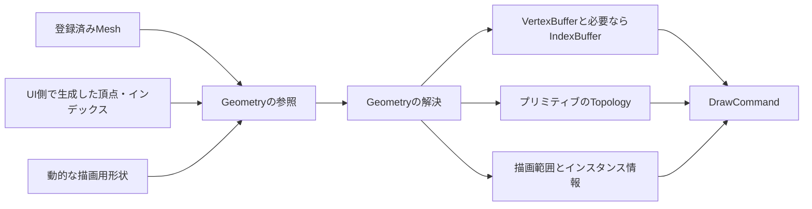

図5：矢印は入力形式の違いを、共通の描画情報へ変換する関係を表す。UI側がDX12の生Bufferを外部APIへ直接渡すことを要求する図ではない。

設計者は、現在のMesh描画とUI描画も、最終的には頂点・インデックスBuffer、Topology、Rangeを渡している点を評価した。この部分を共通にすれば、Mesh Assetを持たないUIも同じDrawCommand経路へ接続できる。[会話 C08](#c08)

Meshというリソース自体を廃止する決定ではない。Meshは登録・管理する単位として残せるが、最終的なDrawCommandの記録層がMeshManagerやEngineのMesh Assetを再検索しなくても済む形へ変換する。

### 4.5 UIの共通化で残る範囲

UIのButton、Text、Imageなどの論理的な要素は、Engine・UIシステム側で描画可能な情報へ変換する。共通化するのは、その後のRenderObjectからDrawCommandへ進む経路である。

UIで必要な描画順、Clip、Scissor、動的Geometryの保持、Textureの切り替えなどの具体的な表現は、UI接続時の詳細設計事項とする。共通化を理由に、必要な描画条件を捨てるわけではない。

Fullscreen描画やCompute処理のように、RenderObjectの集合を必要としない処理は、そのPassのExecuteで別の記録処理を使用できる。すべてを一種類のObjectへ押し込むことは採用していない。

### 4.6 設計判断の要点

「UIも同じRenderObjectに揃えたい」という意図と、「共通ヘルパーがMeshやUIの仕様を知るのは避けたい」という意図を、Geometry解決と共通DrawCommandの間で両立させる。RenderObjectを具体的なComponentの写しにせず、描画情報として共通化することが判断の中心である。[会話 C07](#c07)、[会話 C08](#c08)

---

<a id="chapter-05"></a>
## 5. FrameRendererによる描画構成の作成

### 5.1 FrameRendererの責務

FrameRendererは、FrameRenderDataと描画設定を使い、このフレームでどのPassを使うか、各Passへどの描画対象を渡すか、何を出力させるかを決める。

| 行うこと | 行わないこと |
|---|---|
| 条件式でRenderListを作る | 共通ヘルパーへShadow・Opaqueなどの固定判定を埋め込む |
| 必要なGraph Resourceを宣言・Importする | 各Executeで無断にGraph管理対象を生成・遷移する |
| Pass固有のPipelineやMaterialの使用条件を決める | DrawSettingsにすべてのPipeline設定を複製する |
| Builderを使ってPassを構築し、意図した順で登録する | Graphに意図を推測させて順序を修正させる |

名称は、RenderPathがRenderPassと紛らわしく、SceneRendererではRenderer全体との差が分かりづらかったことから変更した。FrameRenderDataとの対応が分かりやすいという設計者の評価により、FrameRendererを採用した。[会話 C13](#c13)、[会話 C14](#c14)

### 5.2 RenderListは、用途を固定しない集合

RenderListは、OpaqueやShadowという固有の構造を持たない。どの集合になるかは、構築時に渡す条件式と、それを使用するPassで決まる。

```cpp
RenderList opaqueList = BuildRenderList(
    frame.GetRenderObjects(),
    [&](const RenderObject& object)
    {
        return IsVisible(object, view)
            && IsOpaque(object);
    });
```

ここで使う条件式は、一つのRenderObjectを受け取って`bool`を返す**述語**である。ソート用の比較関数が二つの要素の前後関係を判定するのとは役割が異なる。

#### 保存形式の候補と、設計者の意図

会話では値配列の別名という案が出され、その後、ポインタやインデックス配列も候補として説明された。Notionには、RenderObjectのコピーを量産したくないこと、不用意なポインタ使用を避けたいことから、インデックス配列を好むという設計者自身の記述がある。[会話 C17](#c17)、[記録 N10](#n10)

その意図は採用済みの設計理由として残すが、保存型は未決定である。本書の一連のコードは、その候補を一貫して説明するため、次の形式を仮定する。

```cpp
// 説明用の選択。整数幅と保存形式は実装時に決める。
using RenderObjectIndex = std::size_t;
using RenderList = std::vector<RenderObjectIndex>;

template<class Predicate>
RenderList BuildRenderList(
    std::span<const RenderObject> source,
    Predicate&& predicate)
{
    RenderList result;

    for (std::size_t index = 0; index < source.size(); ++index)
    {
        if (predicate(source[index]))
        {
            result.push_back(index);
        }
    }

    return result;
}
```

この関数は判定をその場で行う。述語自体を後から実行するために保存しない。返すインデックスは、渡した`source`に対応するものであり、任意の別配列に対して使える永続Object IDではない。

### 5.3 対象の選別と、描画順の整理

対象選別は共通のDraw処理より前で行う。Shadowの対象は、Scene Cameraから見えるものをさらに絞る方式に固定しない。画面外にある物体の影が画面内へ入る場合があるため、影の生成に必要な対象集合を別の条件で作る。[会話 C11](#c11)

並べ替えが必要なRenderListには、別途比較関数を適用する。

```cpp
template<class Compare>
void SortRenderList(
    RenderList& list,
    std::span<const RenderObject> source,
    Compare&& compare)
{
    std::sort(
        list.begin(),
        list.end(),
        [&](RenderObjectIndex a, RenderObjectIndex b)
        {
            return compare(source[a], source[b]);
        });
}
```

この関数も、透明描画やUIを知る必要はない。必要な順序の条件は呼び出し側が用意する。

| 並べ替えの対象 | 今回の扱い |
|---|---|
| RenderPassの順序 | 登録順を保持し、自動では変えない |
| RenderList内の順序 | 透明描画などの正しさに必要な順序を、構築側で決める |
| DrawCommand配列の最適化順序 | 初期は追加しない。必要な描画順を破壊しないことが前提 |

NotionにはSortRenderListを共通ヘルパーとして用意する考えも残されている。実装上、標準のソートを直接使うか薄い補助関数を置くかは、責務を変えない範囲の詳細設計事項である。[記録 N11](#n11)

### 5.4 パスを登録する全体例

以下は、**一つのRenderViewをSwapChainへ出力する構成例**である。FrameRenderDataを一つのViewに限定する仕様ではない。また、Shadow、Bloom、UIなどを今回すべて新規実装する確定タスクでもない。

`AddShadowPass`などは、FrameRenderer内またはパス専用処理として分割する補助関数を表す。内部では必ずBuilderでPassを完成させてから登録する。 この例の前提としてRenderViewは1個以上存在するものとする。Viewがない場合の扱いは、第13章の入力検証と合わせて詳細設計する。

```cpp
Result<void> FrameRenderer::BuildFrameRenderPipeline(
    RenderGraph& graph,
    const FrameRenderData& frame)
{
    // このコード例では最初のViewを説明対象にする。
    // 複数View全体の構築と共有リソースの規則は別途詳細設計する。
    const RenderView& view = frame.GetRenderViews().front();
    const auto objects = frame.GetRenderObjects();

    auto shadowList = BuildRenderList(objects,
        [&](const RenderObject& object)
        {
            return CastsShadow(object)
                && IsVisibleFromLight(object, frame);
        });

    auto opaqueList = BuildRenderList(objects,
        [&](const RenderObject& object)
        {
            return BelongsToWorldRendering(object)
                && IsVisible(object, view)
                && IsOpaque(object);
        });

    auto transparentList = BuildRenderList(objects,
        [&](const RenderObject& object)
        {
            return BelongsToWorldRendering(object)
                && IsVisible(object, view)
                && IsTransparent(object);
        });

    auto uiList = BuildRenderList(objects,
        [&](const RenderObject& object)
        {
            return BelongsToScreenSpaceRendering(object, view);
        });

    SortRenderList(transparentList, objects, BackToFront(view));
    // UIに必要な順序も保持する。具体的な順序情報は未決定。

    // CreateTextureは論理的な必要条件の登録である。
    // 初期実装ではRendererが保持する既存TextureのImportでもよい。
    auto shadowMap = graph.CreateTexture(
        "ShadowMap", DescribeShadowMap(frame));
    auto sceneColor = graph.CreateTexture(
        "SceneColor", DescribeSceneColor(view));
    auto sceneDepth = graph.CreateTexture(
        "SceneDepth", DescribeSceneDepth(view));
    auto output = graph.ImportTexture(
        "BackBuffer", m_backend.CurrentBackBuffer());

    TRY(AddShadowPass(
        graph, frame, std::move(shadowList), shadowMap));

    TRY(AddScenePass(
        graph, frame, view,
        std::move(opaqueList), std::move(transparentList),
        shadowMap, sceneColor, sceneDepth));

    std::optional<GraphTextureHandle> bloom;
    if (m_settings.enableBloom)
    {
        bloom = TRY(AddBloomPasses(graph, view, sceneColor));
    }

    TRY(AddCompositePass(graph, view, sceneColor, bloom, output));
    TRY(AddUIPass(graph, frame, view, std::move(uiList), output));

    graph.SetFinalUsage(output, ResourceUsage::Present);
    return Success();
}
```

`BelongsToWorldRendering`などの条件名は、World描画と画面上の描画が無条件に両方のリストへ入らないことを示すためのものだ。どの属性やLayerで区別するかは未決定であり、Renderer内部へUI Componentの型判定を入れる指定ではない。

`AddBloomPasses`は、Bloomを必要な個数のPassへ分けて登録し、その出力を返す処理を表す。抽出・ぼかし・合成をどの単位へ分割するかは、本書で新しく決めない。無効時は、未生成のBloom Textureを読み取り宣言しない。

### 5.5 BuilderによるScene Passの構築例

次の例では、ViewとLightをDrawSettingsへ格納しない。Executeが必要な共通入力を準備し、その後で対象集合を共通描画処理へ渡す。

```cpp
Result<void> FrameRenderer::AddScenePass(
    RenderGraph& graph,
    const FrameRenderData& frame,
    const RenderView& view,
    RenderList opaqueList,
    RenderList transparentList,
    GraphTextureHandle shadowMap,
    GraphTextureHandle sceneColor,
    GraphTextureHandle sceneDepth)
{
    DrawSettings settings;
    settings.materialBinding = MaterialBindingPolicy::RequiredOnly;

    // この二つはCPU側の値として、このPass用に確定させる例。
    auto viewData = MakeViewParameters(view);
    auto lightData = MakeLightParameters(frame);

    RenderPassBuilder builder;
    builder
        .Name("Scene")
        .Kind(PassKind::Raster)
        .ReadTexture(shadowMap, ShaderStage::Pixel)
        .ColorOutput(0, sceneColor, Clear(view.clearColor))
        .DepthOutput(sceneDepth, ClearDepth(1.0f));

    // Material・GeometryがGraph管理対象を使用する場合も含める。
    // この補助処理の収集方法は詳細設計事項。
    TRY(DeclareDrawResourceUsages(
        builder, frame, opaqueList, settings, m_resources));
    TRY(DeclareDrawResourceUsages(
        builder, frame, transparentList, settings, m_resources));

    builder.Execute(
        [&frame,
         opaque = std::move(opaqueList),
         transparent = std::move(transparentList),
         settings, viewData, lightData, shadowMap]
        (RenderPassContext& context) -> Result<void>
        {
            // 入力値を準備する経路をDrawSettingsから分離する。
            // 実際のGPU Bindingは有効なRoot Signatureの下で行う。
            TRY(context.SetViewData(viewData));
            TRY(context.SetLightData(lightData));
            TRY(context.BindPassTexture("ShadowMap", shadowMap));

            std::vector<DrawCommand> commands;
            TRY(ProcessRenderObjects(
                context, frame, opaque, settings, commands));
            TRY(ProcessRenderObjects(
                context, frame, transparent, settings, commands));

            return RecordDrawCommands(context, commands);
        });

    graph.AddPass(TRY(builder.Build()));
    return Success();
}
```

この例の`RequiredOnly`は、選択したPipelineが要求するMaterial入力を使うという説明用の指定である。MaterialBindingPolicyの全列挙値と厳密な意味は未決定である。

`&frame`は、Renderer::Renderが保持する元データを参照する例である。`AddScenePass`の戻りでは元データを破棄せず、Graphのコマンド記録が終わるまで維持する。Listや設定値はExecuteへ値・移動キャプチャしている。参照をキャプチャしただけでは参照先の寿命は延長されない。[技術資料 T14](#t14)

### 5.6 RenderPassBuilderとAddPassの境界

Builderには、Name、Usage、描画先の設定、Executeなど、生成に必要な情報を集める。`Build()`がPass単体を検証し、完成したRenderPassを返す。`AddPass()`はその完成物を保持する。

```cpp
// 構築方法の例。具体的なデータ型は未確定。
Result<RenderPass> RenderPassBuilder::Build()
{
    TRY(ValidateNameAndExecute());
    TRY(ValidatePassKind());
    TRY(ValidateAttachments());

    // 描画先の指定から対応するUsageを作り、二重入力を避ける。
    auto description = BuildDescriptionAndResourceUsages();
    return RenderPass(std::move(description), std::move(m_execute));
}

PassId RenderGraph::AddPass(RenderPass pass)
{
    RequirePassRegistrationIsOpen();
    PassId id = MakePassId(m_passes.size());
    m_passes.push_back(std::move(pass));
    return id;
}
```

Builder経由でのみ構築し、完成後は原則として設定変更APIを公開しない方向である。Passを変更する場合は再構築する。C++で非公開コンストラクタと`friend`を使う方法は、その実現例である。[会話 C18](#c18)、[記録 N12](#n12)

### 5.7 この設計を選んだ理由

| 設計者の意図 | 採用した構成 |
|---|---|
| RenderListがOpaque等の構造を持つと、パス構築の自由度が下がる | 入力集合と述語で任意の集合を作る |
| パスの都合を共通処理へ持ち込みたくない | 対象の抽出と描画条件を、パス構築側で確定する |
| Builderから完成したPassを受け取る方が分かりやすい | Name・Usage・ExecuteをBuilderへ集約する |
| AddPassを大きくしたくない | 構築と登録を別の責務にする |
| 参照元データをむやみに複製したくない | RenderListの保存形式を比較し、寿命と合わせて詳細設計する |

これらは単なるコード短縮ではなく、どこに描画方式の知識を置くかについての判断である。[会話 C11](#c11)、[会話 C17](#c17)、[会話 C18](#c18)、[記録 N10](#n10)

---
<a id="chapter-06"></a>
## 6. RenderGraphによる使用宣言の解析と実行制御

### 6.1 RenderPassは、使用宣言とExecuteを保持する

一つのRenderPassは、使用するリソースと用途を表すUsage、および後から実行するCPU側の処理を保持する。

| 部分 | 内容 | 読む側 |
|---|---|---|
| Nameなどの識別情報 | 診断や識別のための情報 | Graph、デバッグ表示 |
| Usage | どのリソースを読み、どの用途で書き込むか | Graphの解析処理 |
| 描画先の記述 | 色スロット、深度、Clear／Loadなど | Graphの描画先準備処理 |
| Execute | そのPassの描画命令などを記録する処理 | Graphの実行処理から呼び出す |

構造を説明する例は次のとおりである。

```cpp
using ExecuteCallback =
    std::function<Result<void>(RenderPassContext&)>;

class RenderPass
{
public:
    const PassDescription& Description() const;
    Result<void> Execute(RenderPassContext& context) const;

private:
    friend class RenderPassBuilder;
    RenderPass(PassDescription description, ExecuteCallback execute);

    PassDescription m_description;
    ExecuteCallback m_execute;
};
```

ここで`std::function`を使うことは、RenderObject一個の描画処理を任意関数で差し替える旧案とは別である。Pass単位には自由な描画処理を残し、RenderObjectの共通経路はデータ化されたDrawCommandを用いる。

GraphはExecuteのC++実装を解析してリソースを推測しない。必要な情報はUsageとして先に登録する。UEのRender Dependency Graphも、Passのパラメータと実行用ラムダを登録し、Graphの実行段階でコマンドを記録する構成を持つ。本設計が参考にするのはこの分離であり、UEの全機能ではない。[技術資料 T01](#t01)

### 6.2 Resource Usageで表す内容

UsageはDX12の状態値をそのまま外へ出すものではなく、リソースを何のために使うかを表す。

| 使用方法の例 | 解析で必要になる情報 |
|---|---|
| Pixel Shaderから読む | 読み取り、利用Stage |
| Vertex Shaderから読む | 読み取り、利用Stage |
| 色の描画先にする | 書き込み先、色スロット、既存内容の扱い |
| 深度の描画先にする | 深度利用、読み書き条件、既存内容の扱い |
| コピー元／コピー先にする | 転送の読み書き関係 |
| 表示処理へ渡す | Graph終了後に必要な用途 |

これは初期実装の完全な列挙型ではない。どの用途を最初に対応させるかは第13章で決める。対応していない用途を、別の用途として暗黙に扱わない。

Graph管理対象を通常Materialから読む場合も、Pipeline Overrideによって追加で読む場合も、実際の使用はCompile前に反映する。FrameやPass共通入力として設定することは、Usage宣言を省略してよい理由にはならない。

一方、Graph外で準備・状態・寿命を保証する読み取り専用TextureやGeometryを、初期の管理対象から分ける構成も議論されている。その場合は、どの機能が保証するかを明示する。収集を手動で書くか補助関数で集めるかは詳細設計事項である。

### 6.3 Graph Resourceは、GPU実体そのものではない

Graph Resourceは、Graph内で利用するTextureやBufferを識別し、必要な条件を記録するための論理的な単位である。

| 項目 | 意味 |
|---|---|
| Graph ResourceのHandle | このGraphのリソース表を参照する識別子 |
| リソースの記述 | サイズ、フォーマット、必要な用途など |
| 実際のGPUリソース | バックエンドが生成・保持するTextureやBuffer |
| Descriptor | そのリソースへのアクセス方法を表す情報 |

Graph内のHandleを、Rendererが永続管理するTextureHandleや、Descriptor Heapの添字と混同しない。具体的な識別形式は未決定である。

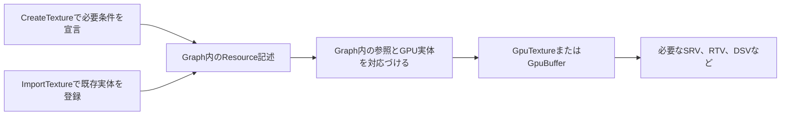

図6：矢印は論理的な参照を、実際の描画で使用する実体へ対応づける関係を示す。

`CreateTexture()`を毎フレーム呼んでも、毎回新しいGPUメモリを生成する必要はない。初期は既存TextureをImportする方式でも成立する。後に物理リソースの再利用やプールを導入できるよう、宣言と確保を分ける。[会話 C05](#c05)、[会話 C24](#c24)

Graphで使う全リソースが一時リソースではない。BackBuffer、Editorへ渡す画像、履歴画像など、Graph外でも保持・利用するものがある。「ShadowMap」「G-buffer」という用途名だけでは寿命を決めない。

### 6.4 登録順を維持する

**採用した方針は、登録順を実行順として維持することである。** 一度トポロジカルソートを検討したが、最終的には自動並べ替えを行わず、構築者が示した順序の検証に戻した。

設計者が述べた理由は、内部で勝手に順序が変わることを避けたいこと、将来の編集機能でも構築者が描画構成を意識できるようにしたいことである。Notionにも同じ意図が記録されている。これは他のRenderGraph一般に並べ替えが不適切だという主張ではなく、今回の明示的な順序を重視した選択である。[会話 C19](#c19)、[記録 N08](#n08)

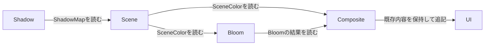

図7：矢印はリソースの内容を利用する依存関係を示す。実行順はFrameRendererが登録した順であり、この図から最適順序を探索する仕様ではない。

依存情報は、診断、デバッグ表示、リソースの使用区間の把握に使える。将来のノードツールやAliasingを考える際の材料にもなるが、それらの実装は初期要件にしない。

### 6.5 依存関係をどう記録するか

登録順に各Passを調べ、Resourceごとに最後の書き込みと、その後の読み取りを記録する方法が、会話中に説明された。

| 調べる関係 | 保持する順序の意味 |
|---|---|
| 書き込みから読み取り | 生成された内容を、その後で使う |
| 読み取りから上書き | 必要な内容を読み終えてから置き換える |
| 書き込みから次の書き込み | 指定した内容更新の順序を維持する |

初期実装で並べ替えなくても、この情報から「どの結果をどのPassが使うか」を記録できる。ただし、読み取り宣言だけから利用者の意図を完全に推測することはできない。

例えば、既存Textureに前フレームの有効な画像があれば、その読み取り自体は成立する可能性がある。「本当は後から登録するPassの今回の画像を読みたかった」という意図までは、単なるRead宣言から確定できない。

### 6.6 内容の有効性とResource Stateは別に扱う

Textureが存在し、Shader読み取りに適した状態であっても、必要な内容が生成されているとは限らない。

| 判定 | 質問 |
|---|---|
| リソースの存在 | Handleから実体を解決できるか |
| 用途・状態の適合 | 指定した読み書きが可能か |
| 内容の有効性 | この時点で読むべき内容が生成・保持されているか |

`Clear`は指定値で描画先を初期化する。`Load`は既存内容を保持して使用する。UIを完成画像へ重ねる場合のLoadは、BackBufferをShaderからサンプリングする宣言ではなく、既存の描画先の内容を残す指定である。

警告・エラー例は、成立条件と一緒に扱う。

| 例 | 診断を成立させる条件 |
|---|---|
| Sceneより先にBloomがSceneColorを読む | SceneColorに有効な初期内容がなく、その時点までに必要な内容が生成されていない |
| 新しい描画先をLoadする | 保持すべき有効な内容が存在しない |
| 先行Passの出力が使われず上書きされる | 後続のClearや全面置換などにより、先行内容が不要になったことを確認できる |
| 同じResourceへ二つのPassが書く | それだけではエラーでも不要処理でもない。追記、ブレンド、部分描画の場合がある |

診断の厳密な分類、実行停止の範囲、停止後の画面は詳細設計で定める。安全性が保証できない実行を継続しないことと、明確な診断を出すことが基本方針である。

### 6.7 Compileは実行計画を作る処理

Compileは、登録された情報を調べて、各Passの開始前後に必要な操作を準備する。解析中は独立した状態表を使い、実リソースの状態が変化したとは扱わない。

```cpp
Result<void> RenderGraph::Compile()
{
    InvalidatePreviousPlan();

    // 同一Pass内で同じリソースが複数回現れる場合もまとめて検証する。
    auto descriptions = TRY(NormalizeAndValidateDeclarations(m_passes));
    auto initialConditions = TRY(ResolveInitialResourceConditions());

    CompiledGraph candidate;
    auto plannedStates = initialConditions.states;
    auto contents = initialConditions.contents;
    auto dependencies = MakeDependencyRecords();

    for (PassId id : RegistrationOrder())
    {
        const auto& description = descriptions[id];

        TRY(ValidateContentsAndRecordDependencies(
            description, contents, dependencies, candidate.diagnostics));

        CompiledPass compiled;
        compiled.sourcePass = id;
        compiled.barriers = TRY(PlanTransitions(
            description, plannedStates));
        compiled.attachments = TRY(ResolveRasterAttachments(description));
        compiled.outputLayout = DescribeOutputLayout(compiled.attachments);
        compiled.clearOperations = BuildClearOperations(description);

        candidate.passes.push_back(std::move(compiled));
    }

    candidate.finalBarriers = TRY(PlanFinalUsages(plannedStates));
    candidate.dependencies = std::move(dependencies);

    // 成功した計画だけを実行可能にする例。
    CommitCompiledPlan(std::move(candidate));
    return Success();
}
```

このコードは、解析結果をまとめて採用する一つの説明方法である。保存形式を確定するものではない。重要なのは、Compileに失敗した途中結果や、変更前の古い計画をExecuteが使わないことである。

同一Pass内で複数Stageから同じTextureを読む場合、Usageを順番に別々の状態へ置き換えるだけでは不十分になる。対応する読み取り用途をまとめるか、初期対応範囲外として診断する。UAVなどの追加用途を、単純な状態値の等値比較だけで処理できると考えない。[技術資料 T05](#t05)

### 6.8 描画先とOutputLayout

CompiledPassには、実際の描画先と、Pipeline適合性を確認する条件の両方が関係する。

| 情報 | 意味 | 含めないもの |
|---|---|---|
| Raster Attachments | このPassで実際に使う色・深度の描画先とClear／Load | ShaderのMaterial値 |
| OutputLayout | 色出力の数と形式、深度形式、サンプル条件など | Texture実体、RTV／DSVのハンドルそのもの |

DX12のGraphics PSOには色出力数、RTV形式、DSV形式、サンプル設定などが含まれる。したがって、選択したPipelineが現在のPassの描画先に対応するかを確認する必要がある。[技術資料 T03](#t03)

```text
CompiledPass
  ├─ 実際の描画先
  │    Color 0 → SceneColorへのRender Target View
  │    Depth   → SceneDepthへのDepth Stencil View
  │
  └─ OutputLayout
       色出力数と各Viewの形式
       深度Viewの形式
       サンプル数などの条件
```

Texture本体が型なし形式で作られる場合もあるため、適合性に使うのは実際に設定するViewの形式である。解像度が変わることと、PSOの出力形式が変わることも同一ではない。

色は複数出力を表す配列、深度・ステンシルは省略可能な単一出力として区別する。色と深度の違いは描画方式の固有知識ではなく、ラスタライズの出力方法の違いである。DX12の`OMSetRenderTargets`も色の配列と深度の指定を分けている。[技術資料 T09](#t09)

固定長・可変長などの実際のコンテナは未決定である。固定長配列の未使用要素があるだけでは、未使用のGPU Textureまで確保されるわけではない。

MRTは、この色出力配列に複数の描画先を設定する形へ拡張する。実際の対応にはShader出力、Pipelineの形式、Blend設定なども合わせる必要があり、配列化だけでDeferred Rendering全体が完成するわけではない。

### 6.9 Execute前の準備と、実行本体

GraphはUsageとCompiledPassから、必要なバリア、描画先設定、Clearなどを記録し、その後でPassのExecuteを呼ぶ。

```cpp
Result<void> RenderGraph::Execute(CommandContext& commands)
{
    TRY(RequireValidCompiledPlan());

    for (const CompiledPass& compiled : m_plan.passes)
    {
        TRY(commands.RecordBarriers(compiled.barriers));

        if (compiled.attachments)
        {
            TRY(commands.BindRasterAttachments(*compiled.attachments));
            TRY(commands.RecordClears(compiled.clearOperations));
        }

        RenderPassContext context(
            *this, commands, compiled, m_resources);

        const RenderPass& pass = m_passes[compiled.sourcePass];
        TRY(pass.Execute(context));
    }

    TRY(commands.RecordBarriers(m_plan.finalBarriers));
    return Success();
}
```

`RenderPassContext`は、現在のPassで使用できるリソース、OutputLayout、コマンド記録機能などへ接続する。描画関数が宣言していないGraph Resourceへアクセスした場合に検証できる構造を考える。

ViewportやScissorの共通設定をどこまでGraph側へ置くか、個別Drawでの変更をどう表現するかは未決定である。色・深度の描画先、Clear／Load、Graph管理対象の状態遷移をExecuteの外へ置く方針と、これらの細部は分ける。

### 6.10 この設計が保証する範囲

Graphは、宣言された情報と対応済みの使用方法に基づいて整合性を確認する。Executeが未宣言のリソースを使ったり、Graph外から実体を書き換えたりすれば、宣言だけでは安全性を保証できない。

したがって「RenderGraphがすべての誤りを防ぐ」とは説明しない。構築者の意図を明示でき、検証可能な条件を増やし、共通の準備処理を集約することが効果である。効果が実装で得られたかは第13章の確認項目で検証する。

---

<a id="chapter-07"></a>
## 7. RenderObjectからDrawCommandへの変換と共通描画

### 7.1 共通化する二つの処理

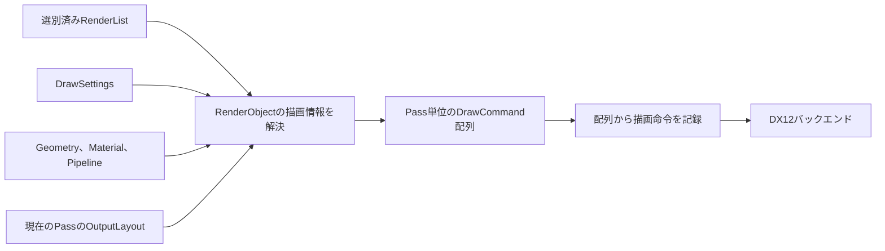

図8：矢印はデータ変換と、その変換に必要な入力を示す。

第一段階ではRenderObjectのGeometry、使用するMaterialとPipeline、必要な入力を解決する。第二段階では解決済みの情報を使って命令を記録する。

これは、RenderObject一つの描画を任意の`std::function`で外から渡す案を、そのまま中心機能にはしなかった結果である。描画処理全体を任意関数へ隠すと、共通化が単なるループの代替になり、Drawに必要な情報の検証や配列処理が難しくなるという説明を受け、設計者は「描画処理関数を渡すのはやりすぎ」と整理した。[会話 C07](#c07)

### 7.2 DrawCommandは初期から配列化する

設計者は、即時に一つずつDrawする方法との実装差が大きくないなら、最初から配列へまとめたいと判断した。将来の最適化を実装する前でも、生成した描画情報と、その命令記録を分けられるためである。[会話 C08](#c08)

配列は基本的にPass単位とする。同じ配列にOpaqueとTransparentの変換結果を追加する場合は、必要な順序を保持する。すべてのPassを一つの配列へ混ぜ、Pass境界を見失う構造にはしない。

**DrawCommandの配列化は、GPUのDraw呼び出しを一回にまとめることではない。** 初期は配列内の各要素から、それぞれ対応するDrawを記録する。ソート、バッチ化、インスタンシングは別の最適化機能である。

### 7.3 DrawSettingsの範囲

```cpp
// 意味を示す例。BindingPolicyの列挙値等は最終確定ではない。
struct DrawSettings
{
    std::optional<MaterialHandle> materialOverride;
    std::optional<PipelineHandle> pipelineOverride;
    MaterialBindingPolicy materialBinding;
};
```

| 設定 | 意味 |
|---|---|
| Material Override | RenderObjectが通常参照するMaterialを、今回の変換で置き換える |
| Pipeline Override | 選ばれたMaterialのPipelineを、今回の変換で置き換える |
| Material Binding Policy | 選ばれたMaterialから、どの要求入力を使用するかを指定する |

Frame、View、Light、Pass共通入力はDrawSettingsの主対象から分離した。Overrideは、基本的にRenderObjectの描画方法を変えるためのものとして扱う。[会話 C20](#c20)、[会話 C21](#c21)

優先順位は次のとおりである。

```text
RenderObjectのMaterial
    → Material Overrideがあれば置き換える
    → 選ばれたMaterialのPipeline
    → Pipeline Overrideがあれば置き換える
```

**DrawSettingsを第二のPipeline Descriptionにしない。** Blend、Depth、Cull、色の書き込み設定などの個別Overrideを際限なく追加せず、必要な組み合わせをPipelineとして指定する。設計者が特に重要と評価した判断である。[会話 C10](#c10)、[会話 C11](#c11)、[記録 N13](#n13)

### 7.4 RenderListからCommand配列を作る

```cpp
Result<void> ProcessRenderObjects(
    RenderPassContext& context,
    const FrameRenderData& frame,
    const RenderList& list,
    const DrawSettings& settings,
    std::vector<DrawCommand>& destination)
{
    const auto objects = frame.GetRenderObjects();

    for (RenderObjectIndex index : list)
    {
        if (index >= objects.size())
        {
            return Error("RenderListが有効範囲外の要素を参照している");
        }

        destination.push_back(
            TRY(BuildRenderCommand(context, objects[index], settings)));
    }

    return Success();
}
```

共通処理に`if (castShadow)`や`if (transparent)`などのPass固有の対象選別を入れない。GeometryやMaterialを解決して初めて分かる不適合は検証結果として扱い、対象選別の代わりに見えない条件で除外しない。

この疑似コードは、最初の変換エラーを呼び出し元へ返す例である。個別Objectのみスキップする最終仕様が確定しているわけではない。スキップ方針を採用する場合も、警告・エラーと継続範囲を揃える必要がある。

### 7.5 BuildRenderCommandの処理

```cpp
Result<DrawCommand> BuildRenderCommand(
    RenderPassContext& context,
    const RenderObject& object,
    const DrawSettings& settings)
{
    auto& resources = context.Resources();

    auto geometry = TRY(resources.ResolveGeometry(object.geometry));

    MaterialHandle materialHandle =
        settings.materialOverride.value_or(object.material);
    auto material = TRY(resources.ResolveMaterial(materialHandle));

    PipelineHandle pipelineHandle =
        settings.pipelineOverride.value_or(material.pipeline);
    auto pipeline = TRY(context.Pipelines().ResolveForDraw(
        pipelineHandle,
        geometry.vertexLayout,
        geometry.topology,
        context.OutputLayout()));

    // RendererとShaderの共通規約で定めるObject情報を準備する。
    // 具体的なフィールドや配置は詳細設計事項。
    auto objectBytes = TRY(PrepareObjectConstants(object));
    auto objectAllocation =
        TRY(context.DynamicData().StoreConstants(objectBytes));

    // 選択後のPipelineが要求するMaterial入力を使う。
    auto materialInput = TRY(ResolveMaterialBindings(
        pipeline.materialLayout, material, settings.materialBinding));

    auto materialConstants = TRY(PackMaterialConstants(
        pipeline.materialLayout, materialInput.values));
    // Textureだけを使い、Material定数がない場合もある。
    std::optional<ConstantAllocation> materialAllocation;
    if (!materialConstants.empty())
    {
        materialAllocation =
            TRY(context.DynamicData().StoreConstants(materialConstants));
    }

    auto materialResources = TRY(context.BindingStorage().Build(
        pipeline.materialLayout, materialInput.resources));

    DrawCommand command;
    command.pipeline = pipeline.reference;
    command.geometry = geometry.drawGeometry;
    command.drawArguments = geometry.drawArguments;
    command.objectConstants = objectAllocation;
    command.materialConstants = materialAllocation;
    command.materialResources = materialResources;

    // 実際の保持方式は未決定。少なくともGPU使用完了まで必要。
    context.RetainForSubmission(geometry, pipeline, materialResources);
    return command;
}
```

ここでは、Frame・View・Lightの供給元を探す汎用Resolverを呼ばない。共通入力はPass側などで別に準備する。ただし、選ばれたPipelineが共通入力の規約と互換であるかの確認や、有効なBindingの設定は必要である。

このコードは、Object定数とMaterial定数をそれぞれ一つの領域として書いた概略である。複数の定数バッファを扱う場合、不要なブロックがある場合、Textureのみを使う場合などの完全な表現ではない。実装時には実際の要求に合わせ、空の定数データを不必要に確保しない。

### 7.6 Pipelineの取得と生成を区別する

`ResolveForDraw()`は、指定されたPipelineがGeometryとOutputLayoutへ対応するかを確認し、使用する実体を取得する処理を表す。

Pipelineを完全な固定PSOとして登録する方式なら、主に適合性を検証する。条件別のPSOを内部で持つ方式なら、該当する実体を取得し、必要な場合に生成する。どちらの方式かは未決定である。

Graphics PSOには頂点入力、Topologyの種類、Shader、描画先形式などの条件が関係するため、共通Objectパラメータが存在するだけで適合すると判断しない。[技術資料 T03](#t03)

### 7.7 最後の命令記録

```cpp
Result<void> RecordDrawCommands(
    RenderPassContext& context,
    std::span<const DrawCommand> commands)
{
    auto& recorder = context.Commands();

    for (const DrawCommand& command : commands)
    {
        TRY(recorder.SetPipelineAndRootSignature(command.pipeline));

        // Pass側で準備した共通入力を、有効な設定先へ反映する。
        // 必要なら再設定する責務であり、供給元を再選択する処理ではない。
        TRY(context.ApplyPreparedCommonInputs(command.pipeline));

        TRY(recorder.BindObjectConstants(command.objectConstants));
        if (command.materialConstants)
        {
            TRY(recorder.BindMaterialConstants(*command.materialConstants));
        }
        TRY(recorder.BindMaterialResources(command.materialResources));
        TRY(recorder.BindGeometry(command.geometry));
        TRY(recorder.RecordDraw(command.drawArguments));
    }

    return Success();
}
```

`ApplyPreparedCommonInputs()`は、第9章で説明する共通データの設定と、Root Signature変更時などの再Bindingを区別するための説明用処理である。PipelineやMaterialからViewを新たに選び直す汎用Scope機構を追加するものではない。

最終のGeometry情報から、Indexed／Non-indexedのDraw、Topology、Rangeを選ぶ。Mesh AssetやUI Widgetをこの段階で再解釈する必要はない。

### 7.8 Overrideの適合範囲

一般的な共通入力だけを要求するPipelineは、多くの対象へ適用しやすい。しかし、共通入力の存在はGeometry形式やShaderでの頂点変形まで保証しない。

Alpha Cutout、頂点変形などに固有入力が必要なら、対応するPipelineと入力を用意し、適合するRenderObjectだけをRenderListへ抽出する。すべての対象に特殊な値を生成して与えることを、PipelineOverrideだけの責務にはしない。[会話 C18](#c18)、[会話 C21](#c21)

---
# 第Ⅲ部：描画を支えるリソース・Shader入力・DX12基盤

<a id="chapter-08"></a>
## 8. リソース管理とShader・Pipeline・Materialの分離

### 8.1 リソースの管理主体

描画に使用するリソースはRenderer側で管理する。EngineのAssetシステムは、ファイルやアセットの識別と、Rendererへの登録・更新・破棄を接続する。利用側は通常、RendererのHandleを使用し、DX12実体を直接変更しない。[会話 C01](#c01)、[記録 N03](#n03)、[記録 N19](#n19)

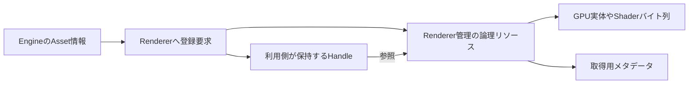

図9：矢印は登録後の参照関係を示す。登録APIを呼んだ瞬間に、すべてのGPU処理が完了することを示していない。

### 8.2 受付、利用可能性、解放を分ける

| 操作 | 方針 | 詳細設計に残すこと |
|---|---|---|
| 登録 | 種類別APIで要求を受ける | バイト列や説明情報の所有、Handle発行時点 |
| 内部準備 | Rendererが決めた時点で処理する | 作成・転送・検証の順序、失敗状態 |
| 更新 | 所定のAPIを通して変更する | どのフレームから反映するか、更新単位 |
| 取得 | Handleや読み取り用メタデータを返す | 返す情報の所有と寿命 |
| 破棄 | 要求と実体の解放を分ける | 使用完了の追跡、無効Handle、依存参照の扱い |

Resourceの「準備状態」とDX12のResource Stateは別の情報である。前者は登録や読み込みの進行、後者はGPUがリソースを利用する用途に関係する。さらに、「後続の描画が利用できる順序を構築したこと」と「GPU転送が完了したこと」も分ける。

Pending、Ready、Failedといった状態名や、未準備リソースの代替表示は会話で候補が示されたが、厳密な状態遷移表は未決定である。

### 8.3 HandleとRevision

Handleは利用側からの参照を保ち、Revisionは中身の更新を識別するために使う。Shader再読み込みでは同じHandleを維持する。

| 情報 | 解決する問題 |
|---|---|
| Handle | どの論理リソースを使うか |
| Revision | そのリソースの内容が前回から更新されたか |
| Generationを持つHandleという候補 | 解放されたスロットを再利用したとき、古いHandleを検出する |

Generationの採用、整数幅、無効値、参照数管理などは未決定である。擬似コードに`index`と`generation`が出たことだけで実装形式を確定しない。

### 8.4 Shader・Pipeline・Materialの役割

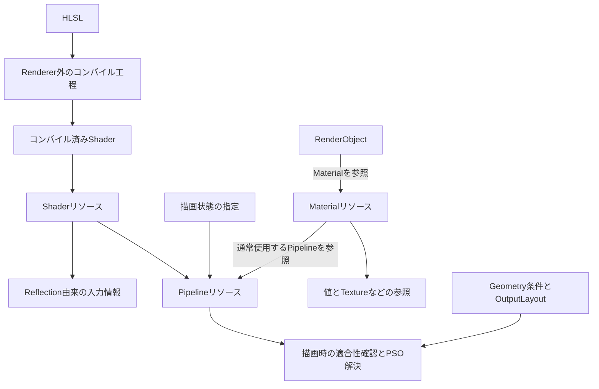

図10：矢印は成果物の生成とリソースの参照を示す。Materialが各描画先Textureを所有することを意味しない。

| 単位 | 主な情報 | 分離する理由 |
|---|---|---|
| Shader | コンパイル済みコード、Stage、Reflection情報、Revision | コードの更新と、描画状態や値の指定を分ける |
| Pipeline | Shaderの組み合わせ、描画状態、入力と出力への条件 | Shaderをどの描画条件で使うかをまとめる |
| Material | 通常のPipeline指定、論理パラメータ、Texture等の参照 | 同じ描画方式へ渡す値や画像を独立して管理する |

NotionではShaderの固定選択を改善すること、PSOKeyをPipelineの原型として扱うこと、Materialを描画単位から参照することが記されている。[記録 N04](#n04)、[記録 N14](#n14)

MaterialとRenderObjectは、必ず一対一で別々に生成する関係ではない。複数Objectが同じMaterialを参照することを禁止しない。共有Materialの値を更新することと、一つのRenderObjectだけのTintを変えることは、影響範囲が異なる。

### 8.5 Shaderのコンパイルと登録

HLSLのコンパイルはRendererの通常の登録責務に含めない。会話では、FrameWorkのCMakeListsにコンパイル工程があることが説明され、コンパイル済み`.cso`を登録して使用する方向で合意した。[会話 C03](#c03)

公開APIで`IDxcBlob`や`D3D12_SHADER_BYTECODE`を要求する必要はない。バイト列を渡す、ファイルパスを渡す、Asset側で読み込んだ結果を渡す方式が比較されたが、最終形式は未決定である。

| 方式の候補 | 分けて考える点 |
|---|---|
| バイト列を渡す | ファイルシステムに依存しないが、入力データの保持・コピーの規則が必要 |
| パスを渡す | 読み込み場所をRendererまたは補助機能で決める必要がある |
| Asset経由で渡す | Engine側の識別情報とRendererリソースを接続するが、RendererにEngine固有Asset型を要求しない |

ShaderにはTextureのような`ID3D12Resource`を必ず割り当てるわけではない。DX12ではコンパイル済みコードをGraphics PSOの記述へ渡す。Shaderという論理リソースとPSO実体は分けて扱う。[技術資料 T03](#t03)

### 8.6 Pipelineの確定範囲

Pipelineとして、Shaderと固定機能の描画状態をまとめる方針は採用している。一方、一つのPipelineHandleが完全な一つのPSOを表すか、入力・出力条件ごとのPSOを内部で解決する論理定義を表すかは未決定である。

この違いを、説明用の`ResolveForDraw()`が隠している。詳細設計では、生成時点、キャッシュのキー、Shader更新時の無効化、Root Signatureとの関係を決める。

OutputLayoutには描画先の条件が入るが、どのTextureへ書くかの選択はGraphが行う。Pipeline解決側が適合させるために、Graphの描画先を勝手に変更しない。

### 8.7 Materialの値とGPU配置

Materialは、パラメータの名前・型・値とリソース参照を、論理的な情報として持つ。GPU上のバッファオフセットだけを、Material Assetの永続的な意味にしない。

CPU側の論理値をどう保存するかは未決定である。名前付きの値の一覧、Layoutに対応したバイト列のキャッシュなどを選べる。重要なのは、Shader更新やPipeline Overrideで配置が変わっても、何の値かを失わないことである。[会話 C04](#c04)、[会話 C19](#c19)

### 8.8 設計上の制約

リソースの登録方式を汎用化しても、任意のShader・任意のMaterialが互換になるわけではない。Rendererが供給する共通入力、Material用入力、Geometryの形式には使用規約が必要である。自由に登録する入口と、正しく描くための検証を別の責務として用意する。

---

<a id="chapter-09"></a>
## 9. Shader入力とMaterialパラメータの供給

### 9.1 最後に整理した三つの供給経路

最終整理では、全変数にScopeを付けて供給元を動的に探す仕組みは導入しない。Renderer側の役割に従って、次の三つに分ける。[会話 C20](#c20)、[会話 C21](#c21)

| 区分 | 例 | 値を準備する側 | 注意点 |
|---|---|---|---|
| Renderer共通入力 | Frame、View、Light、Pass固有の入力 | FrameRendererやPassの処理 | 全Viewで常に同一の値とは限らない |
| RenderObject共通入力 | TransformやTintなどの最小限の共通情報 | RenderObjectの描画情報を解決する処理 | 正確な項目と既定値は未決定 |
| Material固有入力 | 任意の定数、Textureなど | Materialの入力解決 | 選択後のPipelineの要求に適合する必要がある |

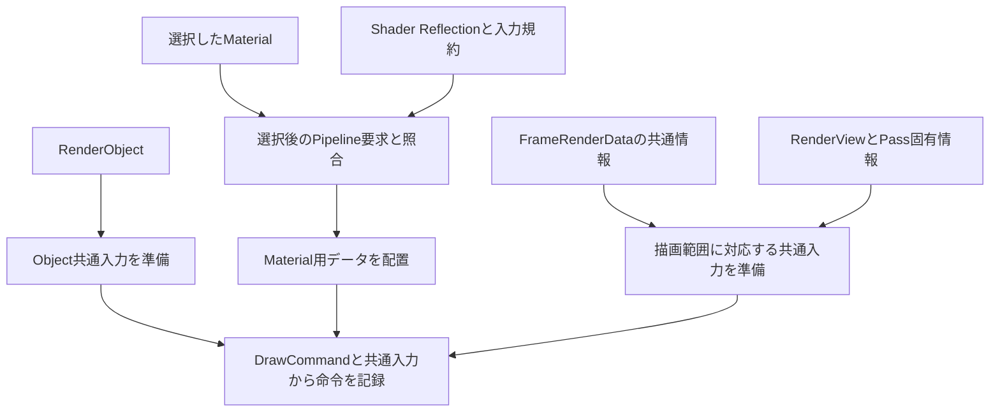

図11：矢印は値の供給経路を表す。各変数へScopeメタデータを付ける方式を示していない。

### 9.2 Scope注釈とコメント解析を今は採用しない理由

設計者は、`space`を供給元の意味に利用してよいか、コメント解析の実装量がどれくらいになるかを懸念した。その後、全Materialへ汎用パラメータを与える案や、RenderObject共通データを設ける案を比較した。

最終整理では、Rendererの共通規約を使い、Material固有入力だけを柔軟に解決する方向とした。これにより、入力の供給元を記す独自注釈、コメントの抽出、条件付きコンパイルとの対応などを初期機能に含めない。[会話 C21](#c21)

ただし、HLSLの`space`自体を禁止するものではない。`register(b0, space2)`はレジスタ空間の指定であり、異なる空間では同じレジスタ番号を区別できる。空間を用途ごとに分けることは技術的に可能だが、番号2がMaterialを意味するのはアプリケーション側の規約である。[技術資料 T15](#t15)

Scope注釈を採用しなくても、共通入力とMaterial固有入力を識別する規約は必要である。予約する定数バッファ、名前、Register Space、Root Signatureの構成などの具体案は詳細設計へ残す。

### 9.3 共通データを先に準備する意味

ViewやLightの値は、各RenderObjectから毎回供給元を探すのではなく、対応する描画範囲に対して準備する。Scene PassはそのViewのカメラ、Shadow PassはLight View、画面上の描画は対応する座標変換を使う。

ここでは、次の三つを分ける。

| 操作 | 意味 |
|---|---|
| 値を決める | どのView行列やLight情報を使用するか確定する |
| GPU参照領域へ置く | 必要なバイト列を、使用中に上書きしない領域へ配置する |
| Bindingする | 現在のRoot Signatureなどに従って、Shaderが参照できる設定を行う |

値の準備を一度にまとめても、Binding命令を常に一度だけで済ませるとは限らない。DX12では異なるRoot Signatureへ切り替えると、それまでのRoot Bindingを再設定する必要がある。PSO設定そのものとRoot Signature設定も別の操作である。[技術資料 T04](#t04)

第7章の`ApplyPreparedCommonInputs()`はこの制約に対応する説明用の境界である。共通データの値を決める責務はPass側に置いたまま、バックエンドは有効な設定を保証する。

### 9.4 全Materialに共通パラメータを増やす案との比較

設計者は、色などを毎回HLSLへ書く負担を減らし、Override時の入力の存在を揃えるため、全Materialに最低限のパラメータを用意する案を考えた。同時に、それを使わないMaterialにも余分な領域が必要になる点を懸念した。[会話 C21](#c21)

最終整理では、すべてのMaterialへ多数の項目を強制するより、最小限のRenderObject共通入力を定める方向とした。

| 共通Object入力の候補 | Material固有入力の例 |
|---|---|
| Transform | Roughness |
| ObjectColorまたはTint | Metallic |
| ObjectId | BaseColorTexture |
| 必要なら派生行列 | 特殊なAlphaThresholdやDissolve値 |

候補の全項目を必須と決めたわけではない。特に`ObjectId`、逆転置行列、色の型などは詳細設計で必要性を確認する。

ObjectのTintとMaterialのBaseColorも別の意味を持つ。両方を使うShaderでは乗算などで合成できるが、その計算を全Shaderが自動的に行う仕様ではない。

#### メモリの判断基準

最小共通入力にもメモリは必要である。採用時には、CPU側RenderObjectのサイズ、GPU向けバッファのサイズ、Draw数、同時に保持するフレーム数を分けて確認する。

「GPUに送らないので無料」「共通化したので必ず小さい」とは判断しない。一方、共通定数を持つことは、Material一個ごとに独立したGPU ConstantBufferを永久に作ることと同義ではない。動的領域への配置で扱える。

未使用メンバーを除いて部分的に詰め直す場合も、Shaderが期待するオフセットを勝手に圧縮してはならない。固定Layoutを採用するか、複数Layoutへ分けるかは、その規約と合わせて決める。[技術資料 T08](#t08)

### 9.5 Reflectionで取得するもの

Shader Reflectionは、コンパイル結果からShaderの入力やバインディング情報を調べるために使う。DX12のReflection APIでは、定数バッファ、変数、入力・出力パラメータ、リソースBindingなどを取得できる。[技術資料 T10](#t10)

| 取得する情報 | 使用する箇所 |
|---|---|
| 変数名と型 | Material値の対応づけと型検証 |
| 定数バッファ内の配置 | GPU向けバイト列の生成 |
| Texture等の名前、種類、Binding位置 | リソース参照の設定 |
| Shaderの入力条件 | PipelineとGeometryの適合性確認 |

変数の`StartOffset`は所属する構造の先頭からの位置であり、GPUメモリアドレスではない。TextureのBinding番号と定数のバッファ内オフセットも別の情報である。[技術資料 T11](#t11)、[技術資料 T12](#t12)

コンパイル済みShaderから得られる情報を使うため、HLSLに書いた未使用宣言までMaterial項目として残ると一律には保証しない。対応する型・配列・構造体、最適化後に取得できる情報の扱いは詳細設計で明示する。

### 9.6 Override先の要求へMaterial値を対応づける例

以下はMaterial固有部分だけを示すHLSL例である。Renderer共通定義の供給方法やRegister番号は省略し、その具体規約を確定しない。

通常ShaderのMaterial入力：

```hlsl
cbuffer MaterialParams
{
    float4 BaseColor;
    float Roughness;
    float AlphaThreshold;
};

Texture2D OpacityTexture;
```

Override先ShaderのMaterial入力：

```hlsl
cbuffer MaterialParams
{
    float AlphaThreshold;
};

Texture2D OpacityTexture;
```

対象Materialが`BaseColor`、`Roughness`、`AlphaThreshold`、`OpacityTexture`を持っていれば、Override先は必要な二つだけを取得する。`AlphaThreshold`は通常Shader用の元オフセットではなく、Override先Shaderの配置へ書き込む。

| 段階 | 使用する情報 |
|---|---|
| 1 | 選択後のPipelineが要求するMaterial入力 |
| 2 | Material内の同名の値またはリソース参照 |
| 3 | 型、配列、Texture種類などの適合性 |
| 4 | 対象ShaderのオフセットまたはBinding位置 |

```cpp
Result<MaterialInput> ResolveMaterialBindings(
    const MaterialLayout& requiredLayout,
    const Material& material,
    MaterialBindingPolicy policy)
{
    // 必須入力を供給できない方針の指定を、成功として扱わない。
    TRY(ValidateMaterialBindingPolicy(requiredLayout, policy));
    MaterialInput input;

    for (const auto& requirement : requiredLayout.RequirementsFor(policy))
    {
        auto value = material.Find(requirement.name);

        if (!value)
        {
            // 明示した既定値を認めるかも含め、詳細設計で規則を定める。
            return Error("要求されるMaterial入力がない");
        }

        TRY(ValidateCompatibility(requirement, *value));
        input.Add(requirement, *value);
    }

    return input;
}
```

パラメータ名をIDへ変換する方法は候補である。ハッシュの衝突、名前の保存、更新時の再解決などを決めずに、32ビット整数にしただけで安全としない。

### 9.7 値の配置と、GPU領域の確保を分ける

```text
Materialの論理値
    ↓ 名前・型を照合
選択後のShaderが必要とする入力値
    ↓ ShaderのLayoutに従って並べる
定数バッファ用のバイト列
    ↓ Dynamic Dataで領域を確保して格納
GPUから参照できる配置
```

HLSLの定数配置には型、配列、構造体、行列の配置などが関係する。C++型とHLSL型の`sizeof`が同じという理由だけで、常に`memcpy`できるとはしない。初期に対応する型を定め、Reflectionで得たLayoutに合わせる。[技術資料 T08](#t08)

TextureやSamplerは定数値のバイト列に混ぜず、選択したShaderの要求位置へリソース参照として対応づける。

### 9.8 欠けた入力と、任意の既定値

Materialにない入力へ、暗黙に0や白Textureを与える方針は確定していない。既定値を使う場合は、供給元と適用条件を明示する必要がある。

特殊なPipelineが要求する値を全RenderObjectへ自動生成することは、PipelineOverride単体の責務にしない。必要なMaterialを持つ対象を選ぶ、適合するMaterialへOverrideするなど、Pass側の構成でも条件を満たす。

Renderer共通入力だけを使うOverrideは、Material固有値の欠落を避けられる。しかし、頂点属性、頂点変形、Alpha Cutoutなどが必要かどうかは別に確認する。「全Objectに共通値があるので、任意のPipelineをどのObjectにも適用可能」とはしない。

---
<a id="chapter-10"></a>
## 10. GPUデータ配置・寿命管理・DX12バックエンド

### 10.1 二つのデータ配置を区別する

GPU Upload / Dynamic Dataという項目には、次の二つが含まれる。

| 用途 | データの例 | 処理の概観 |
|---|---|---|
| リソース内容の転送 | Textureの画素、Meshの頂点・インデックス | CPUデータを転送用領域に置き、必要ならGPUリソースへコピーする |
| 描画時の動的データ配置 | View、Light、Object、Materialの定数 | 必要な値を保持する領域を確保し、Drawから参照できるようにする |

静的なMeshなどをDefault Heapへコピーして使用する経路と、Upload Heap上の動的定数をGPUが直接読む経路は、用途に応じて区別できる。どちらの配置が常に最適かは断定せず、実装と測定で判断する。[技術資料 T07](#t07)

### 10.2 定数の内容を作る処理と、配置する処理

Material入力の型やオフセットに従ってバイト列を作るのは、第9章のLayoutを扱う機能である。動的データ配置側は、完成したバイト列のサイズとアラインメントに応じて場所を用意する。

```cpp
Result<ConstantAllocation> DynamicData::StoreConstants(
    std::span<const std::byte> bytes)
{
    // 必要な定数ブロックがある場合だけ呼ぶ例。
    if (bytes.empty())
    {
        return Error("配置する定数データが空である");
    }

    constexpr std::size_t alignment = 256; // DX12側の配置条件
    const std::size_t size = AlignUp(bytes.size(), alignment);

    auto allocation = TRY(m_frameUploadAllocator.Allocate(size, alignment));
    std::memset(allocation.cpuAddress, 0, size);
    std::memcpy(allocation.cpuAddress, bytes.data(), bytes.size());

    return MakeConstantAllocationReference(allocation);
}
```

これはMap済みの領域を使う説明用の例であり、Allocatorの形や容量拡張方式を確定しない。定数Bufferの配置アラインメントはDX12では256バイトである。バッファ内部の各変数の配置規則とは別の条件である。[技術資料 T16](#t16)

未使用の定数ブロックは呼び出し側で不要と判断できる。固定した共通Layoutの一部メンバーが未使用な場合に、そのメンバーだけを勝手に詰めて消すこととは区別する。

### 10.3 CPU側の保持とGPU側の保持

| 対象 | 少なくとも必要な保持期間 | 保持の理由 |
|---|---|---|
| FrameRenderData | そのデータを読むCPU側コマンド記録が終わるまで | RenderListやExecuteの参照元になる |
| RenderListとExecuteの設定 | 対応するExecuteでの利用が終わるまで | 登録時の一時変数を後から使う |
| DrawCommand配列 | コマンド記録側が情報を読み終えるまで | 解決済みの描画情報を順番に記録する |
| GPUが読むUpload領域 | GPUの読み取りが終わるまで | CPUが先に上書きすると、意図した値で描けない |
| GPU Texture・Buffer・PSO | それを使用するGPU処理が終わるまで | 描画命令は後から実行される |
| GPUから参照されるDescriptor領域 | 対応するGPUアクセスが終わるまで | 参照内容の差し替えや回収を避ける |

これは、CPUデータを必ずGPU完了まで全部保持するという意味ではない。必要な値を独立したGPU参照領域へ転送した後は、元のCPU表現が不要になる場合がある。逆に、GPUが直接参照する領域は、CPUコールバックが戻っただけでは解放できない。

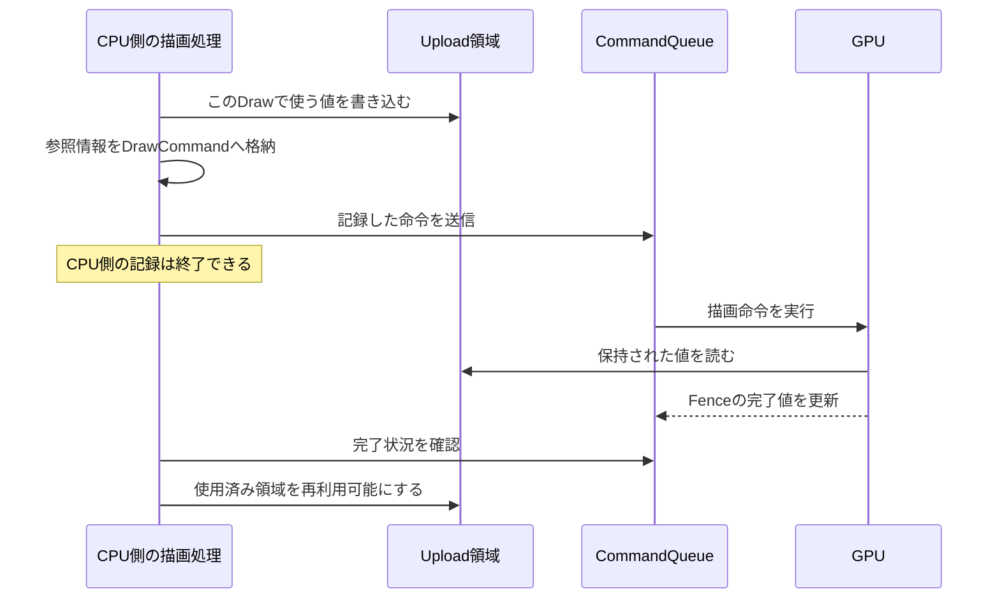

図12：CPUの記録完了とGPUの利用完了の時間差を示す。Fenceを使って使用済み領域を回収する方法は、DX12の公式資料でも示されている。[技術資料 T06](#t06)

### 10.4 複数フレームと複数Viewの値を同時に保持する

同じGPUアドレスへ別の値を書き込み、その前のDrawもそのアドレスを参照したままにすると、値の保持が成立しない場合がある。View AとView B、通常描画とShadow描画、異なるRenderObjectの値は、必要な期間だけそれぞれ保持する。

コマンド用のフレームスロットが分かれていることと、GPUが読む定数データが分かれていることは別である。既存のCommandAllocatorの再利用管理だけで、共有定数Bufferの上書きが安全になるとは考えない。

初期の候補には、フレーム別のUpload領域や、Fenceに基づく領域の回収がある。リングバッファや共有定数のキャッシュの採否は未決定である。

### 10.5 Graph内の使用期間と、物理メモリの再利用

GraphのPassを調べれば、各リソースの最初と最後の使用位置を記録できる。ただし、その情報だけでCPUから実体を解放してよいとは決まらない。

| 区別する期間 | 判断する機能 |
|---|---|
| GraphのどのPassからどのPassまで使うか | Resource Usageの解析 |
| 別フレームやEditorなど、Graph外でも使うか | リソースの所有と外部出力の設計 |
| CPUがUpload領域を上書き・回収してよいか | GPU完了の追跡 |
| 同じGPUメモリを異なるリソースへ割り当ててよいか | 利用順序、配置条件、必要なバリアを含むメモリ管理 |

Aliasingは、複数のリソースが同じHeap領域を共有する方法である。使用区間が重ならないことに加え、配置条件と切り替え時の同期・初期化を扱う必要がある。[技術資料 T17](#t17)

初期はAliasingを実装しない。個別のCommitted Resourceや既存TextureのImportで成立させられる。将来Aliasingを行う場合でも、GPU内の正しい実行順とバリアで再利用することと、CPUがGPU完了を待って別フレーム用メモリを回収することを混同しない。

### 10.6 DX12バックエンドの分割単位

| 機能 | 担当する内容 | 上位との境界 |
|---|---|---|
| Deviceと初期化 | DX12デバイスと基礎設定 | Sceneの内容を決めない |
| GPU Resource Wrapper | Texture・Buffer実体、生成条件、必要なViewへの接続 | 次のPassの用途を単独で決めない |
| Descriptor管理 | 生成・割り当て・更新・再利用 | 公開側はRendererのHandle等で扱う |
| コマンド記録 | 描画先、Binding、Draw、Dispatch、Copyなどの記録 | Passの採否や対象選別を決めない |
| Resource Stateとバリア | 使用計画をDX12の操作へ変換する | Graphと別々に状態を更新しない |
| Queue・Fence | 送信、完了判定、必要な待機 | リソースの回収判断へ完了情報を提供する |
| SwapChain | BackBuffer、Resize、Presentへの接続 | 画面へ合成する内容を決めない |
| Root SignatureとPSO実体 | Shader入力規約、描画条件に対応するDX12実体 | Material値の意味を決めない |

この表はクラス数を指定しない。既存部品の責務をどこへ集めるか、どの操作を共通化するかの分割単位である。

### 10.7 既存機能に対する、会話中の調査記録

以下は、会話中で対象とされた **コミット `3229dfa8db2263c22df71d24a408986f6ff124ab`** の解析記録を整理したものである。本資料作成時の最新コードを再検証した結果ではない。実装計画の作成前に、その後の変更を確認する。[会話 C24](#c24)、[参考実装 R01](#r01)

| 会話中に確認された機能 | 説明された現状 | 改善・移管の対象 |
|---|---|---|
| EngineのDevice初期化 | Device生成などをEngineが持つ | RendererのDX12初期化との責務分離 |
| GpuTexture | Texture生成、View作成、状態遷移、Resizeを扱う | Graphからの参照、生成記述と状態管理の整理 |
| TextureManager | Handle・読み込み・転送待ちの管理を行う | Asset情報とGPU実体管理の接続、転送基盤の共通化 |
| VertexBuffer・IndexBuffer | 個別にBufferを生成する | 共通のBuffer操作と用途別Viewの整理 |
| ConstantBuffer | Map済み領域とGPUアドレスを保持する | フレーム・View・Drawに必要な値の同時保持 |
| DescriptorHeapAllocator | Heap内の添字を割り当てる | 容量、返却・再利用、使用中の保持 |
| CommandContext | CommandAllocatorとCommandListの開始・終了を管理する | Graphに必要な記録操作の接続 |
| CommandQueue | 送信、Fence、待機を提供する | Upload領域や旧リソースの回収への接続 |
| FrameCommandManager | フレームスロットと送信Fenceを扱う | コマンド以外の一時領域との寿命の整合 |
| SwapChain | BackBuffer、Resize、Presentを扱う | GraphへのImportと最終用途への遷移 |
| PipelineState・RootSignature | PSO生成と固定Bindingの基礎を持つ | 論理Pipeline、Reflection情報、Overrideとの適合性 |

RendererのFrame定数などの共有領域については、会話中にGPU使用中の上書きを懸念する指摘があった。ただし実行して不具合を再現した記録ではない。実装前に現在のコードを確認し、再現・検証の結果と分けて記録する。

### 10.8 Descriptor管理で区別すること

リソースHandle、リソース実体、Descriptorは別の寿命や役割を持つ。Shaderから読むView、描画先のView、同じTextureの異なるMipや形式のViewなどを、将来どこまで表すかは詳細設計事項である。

Shader-visibleなDescriptor領域と、RTV／DSVの記録時に使用するDescriptorは、全く同一の利用規則ではない。どれも「Pass終了で必ず破棄」や「必ずGPU完了まで同じCPU領域を保持」と一括に扱わず、DX12の規則に従って整理する。いずれの場合も、そのDescriptorが指すGPU実体は必要な利用期間だけ保持する。[技術資料 T18](#t18)

### 10.9 設計判断と残る事項

設計者はDX12リソースを適切にラップしたいと明示し、Notionでも既存ラッパーの見直しと未整理部分の検討を記している。したがって、全面的な新規実装ではなく、使われ方の判断と具体的操作を分ける方向で進める。[会話 C02](#c02)、[記録 N15](#n15)

State追跡の最小単位、対応するバリア、CommandListの構成、Descriptor容量、Upload領域の容量超過、Resourceの解放時点、Resize中の保持などを実装時に決める。

---

<a id="chapter-11"></a>
## 11. 編集・ホットリロード・情報公開

### 11.1 編集機能との境界

InspectorなどのEditor機能は、Rendererのメタデータを読み、所定の更新APIを呼ぶ。Rendererは、色をColor Pickerで表示するか、数値をSliderで表示するかといったUI仕様を知らない。

Shaderの型・配置・Binding情報を取得する機能と、その情報を画面へ表示する機能は分ける。Renderer内部のReflection情報を、そのままDX12のインターフェースとして返さず、Rendererが定める公開表現に変換する。[会話 C04](#c04)、[記録 N16](#n16)

### 11.2 Parameter変更とShader変更は別の経路

| 変更 | 主に更新するもの | 関係する処理 |
|---|---|---|
| Materialの数値・Texture変更 | Materialの論理値と参照 | 型・参照の確認、描画への反映 |
| Shaderの再コンパイル結果の登録 | ShaderコードとReflection情報 | Revision更新、Pipeline再生成、Layoutの再対応づけ |
| RenderObjectのTransformなど | 次のFrameRenderDataの入力 | 次の描画用データ準備 |

Material値を変更するたびに、必ずShaderを再コンパイルする設計ではない。Shader更新とMaterial値の編集を分けることで、変更内容に応じた処理だけを行える構成を目指す。

### 11.3 ShaderHandleを維持した再読み込み

採用した大枠は、ShaderHandleを維持し、そのリソースの内容を更新することである。依存PipelineはRevisionなどで変更を検知し、必要な実体を再生成する。

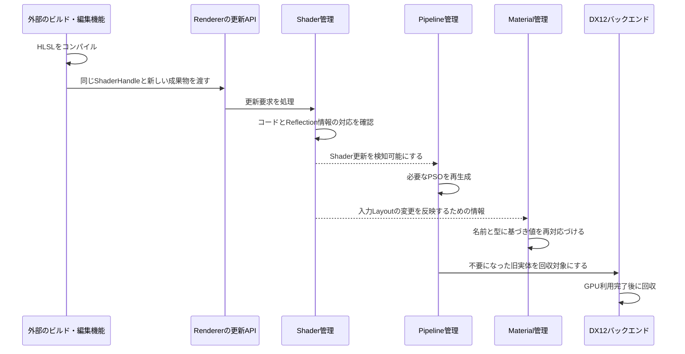

図13：主な依存関係と処理の順序を示す。依存する全実体の切り替えを一つのトランザクションにするか、どの時点でRevisionを更新するかなどの詳細を確定しない。

Handleを変えない理由は、Materialやその他の参照元を全箇所書き換えずに、同じ論理リソースを継続して扱うためである。Resourceの識別と、更新後の内容を分ける設計である。[会話 C04](#c04)

### 11.4 Material値の引き継ぎ

Materialは、値の名前・型を基に変更後のLayoutへ対応づける。位置が変わっただけの同名・同型の値は引き継げる方向にする。一方、名前の変更、型の変更、新規項目、削除項目などの厳密な扱いは詳細設計で決める。

| Shader変更の例 | 保持する方針 | 未決定の細部 |
|---|---|---|
| 同じ変数のオフセットが変わる | 値の意味を保って再配置する | Layoutキャッシュの更新方式 |
| 新しい必須入力が増える | 不足を検出する | 既定値の供給、停止範囲 |
| 型が変わる | 無条件のバイト流用をしない | 変換可能な型を認めるか |
| 名前が変わる | 自動的に同じ意味と推定しない | 明示的な移行表を将来用意するか |

Shaderの初期値、Editorの表示用既定値、Material Assetの保存値が常に同じものだとは決まっていない。どこから既定値を得るかを、Reflectionの存在だけで決めない。

### 11.5 Reflection情報を取得できるビルド成果物

DXCのReflection取得はコンパイル成果物の条件に依存する。`IDxcUtils::CreateReflection`は、対象の情報からReflectionインターフェースを作るためのAPIである。[技術資料 T13](#t13)

一方、DXCにはReflection情報を別に出力する指定や、Shaderコードから除去する指定がある。したがって「`.cso`であれば必ず必要なReflectionが含まれる」とはしない。コードと入力情報が同じコンパイル結果に対応し、Rendererが必要な情報を取得できるよう、ビルド設定と登録方式を揃える。[技術資料 T19](#t19)

別ファイルにすること、JSONへ変換することは必須方針ではない。NotionのJSON表記は実装候補として残し、公開メタデータの内部形式を先に固定しない。

### 11.6 メタデータの公開

| 提供する情報の候補 | 利用側が決めること |
|---|---|
| パラメータの名前・型・配列情報 | 編集項目としてどう表示するか |
| Material用入力Layout | どの値を編集対象にするか |
| リソースの種類・寸法など | 選択画面やデバッグ画面の構成 |
| Shader・Pipeline更新の識別情報 | 表示内容や保持中の参照をいつ更新するか |
| 診断情報 | Editorでどこへ通知・表示するか |

`float4`であることだけから、それが色か、任意の四成分値かを必ず決められるわけではない。UI向け注釈や表示規則は、必要になった段階でEditorまたはAsset側の機能として検討する。RendererへInspector固有のWidget型を加えない。

### 11.7 更新処理で詳細設計すること

更新要求を受けた直後に、全実体をその場で破棄・置換するとはしない。少なくとも、旧実体を使用するGPU処理と、新しいコード・Layoutの検証を区別する必要がある。

未決定事項は、更新失敗時に旧版を維持するか、どの単位で依存Pipelineを切り替えるか、Metadata参照の寿命、ParameterHandleの無効化・再解決、更新中のGraphがどのRevisionを使うかである。

設計者はホットリロードを、Material Editorの後続実装と、描画結果を繰り返し調整する開発に結び付けている。この意図を満たすために更新経路を用意するが、編集UIやファイル監視の実装までRendererの責務へ入れない。[記録 N05](#n05)

---
# 第Ⅳ部：実装計画・詳細設計・検証への引き継ぎ

<a id="chapter-12"></a>
## 12. 初期実装の範囲と既存実装からの移行

### 12.1 初期実装と将来の拡張を分ける

この章はスケジュール策定の材料であり、作業日程を確定するものではない。章の順序は説明の順序であって、そのまま実装順序ではない。

| 項目 | この設計での扱い |
|---|---|
| FrameRenderDataを主要入力とする公開境界 | 採用する |
| RenderViewと共通RenderObject | 採用する。全フィールドと保存型は詳細設計する |
| Renderer管理のShader・Pipeline・Material・Geometry・Texture | 責務を分ける。具体的な管理クラスとAPIは詳細設計する |
| FrameRendererによる毎フレームのPass構築 | 基本方針として採用する |
| RenderPassBuilderによる生成 | 採用する |
| 登録順でのGraph解析・実行 | 採用する |
| Usage検証、バリア、描画先設定、Clear／Load | 初期RenderGraphの中心とする |
| RenderListの述語による抽出 | 採用する |
| DrawCommand配列への変換と記録の分離 | 初期から採用する |
| Pipeline／Material Override | 採用する |
| Renderer共通・Object共通・Material固有入力の分離 | 最終整理として採用する。Binding規約は詳細設計する |
| ShaderHandleを維持する再読み込み、Reflection公開 | 設計対象に含める。Editorや自動監視と実装範囲を分ける |
| GPUデータの保持・安全な回収 | バックエンドへの接続に含める |
| MRT | 将来対応を前提にし、今回の実装は任意とする |
| Deferred Rendering | 将来行いたい描画方式。G-buffer等の全機能を今回必須とはしない |
| Resource Pool、Aliasing | 単純な確保・Importから始められるようにし、高度な再利用は後続候補とする |
| Passの自動並べ替え | 採用しない |
| 不要Pass除去 | 初期必須ではない。不要な可能性の診断とは分ける |
| DrawCommandの最適化ソート・バッチ化・インスタンシング | 初期必須ではない |
| 非同期Compute、複数Queue、並列記録 | 初期必須ではない |
| 外部向けPass構築API、ノード編集ツール | 将来の検討例とする |
| Shader変数ごとのScope注釈、コメント解析 | 現段階では導入しない |

「採用する」は、その機能が実装済みであるという意味ではない。また、再読み込みの大枠を設計対象とすることは、編集・監視・コンパイルの自動化を同じ期限で完成させることを意味しない。

### 12.2 実装単位として整理する項目

以下は、既に議論した機能をスケジュールへ分解するための整理である。新しい採用機能や、Notionに登録する確定タスクではない。

| 実装単位 | 主な内容 | 主な依存先 | 詳細設計前に確認すること |
|---|---|---|---|
| 公開境界とフレーム入力 | FrameRenderData、RenderView、提出・参照の規則 | Engine側の抽出処理 | 所有、提出後の変更、複数Viewの必要情報 |
| リソースの識別と操作 | Handle、登録・更新・取得・破棄 | DX12実体の保持、Asset側接続 | 無効参照、受付時点、準備状態 |
| Geometry共通化 | Mesh・動的Geometryから描画情報を解決 | Buffer管理、フレームデータ | 頂点形式、描画範囲、UIのClipと順序 |
| Shader登録とReflection | コンパイル済み成果物の読み込み、入力情報取得 | ビルド成果物、リソース管理 | Reflectionの取得条件と公開形式 |
| Pipeline管理 | Shader参照、描画条件、PSOの取得・生成 | Shader、Root Signature、OutputLayout | 固定PSOか条件別PSOか |
| Materialと入力解決 | 論理値、Texture、要求との照合 | Reflection、Pipeline、共通入力規約 | 対応型、既定値、共有Materialの更新 |
| 動的データと回収 | 定数の配置、転送用領域、完了後の回収 | Buffer、Queue、Fence | 容量、上書き防止、失敗時の回収 |
| RenderPassとBuilder | 宣言とExecuteの構築・検証 | Graph Resourceの参照形式 | 不変性、Callbackの結果と寿命 |
| RenderGraphの解析・実行 | 登録順の検証、状態、描画先、実行計画 | Builder、Resource、CommandContext | 対応Usage、内容有効性、診断 |
| 共通DrawCommand処理 | RenderObject解決、配列化、命令記録 | Geometry、Material、Pipeline、動的データ | 順序、共通Bindingの再設定、互換性 |
| FrameRenderer | RenderList構築、リソース宣言、Pass登録 | Graph、共通描画、フレーム入力 | どの既存パスを移行するか |
| 編集・再読み込みとの接続 | 値更新、Handle維持、依存更新、Metadata取得 | Resource、Shader、Pipeline、Material、回収 | 失敗時、Revisionの一貫性、Editor側の責務 |

### 12.3 機能間の実装依存関係

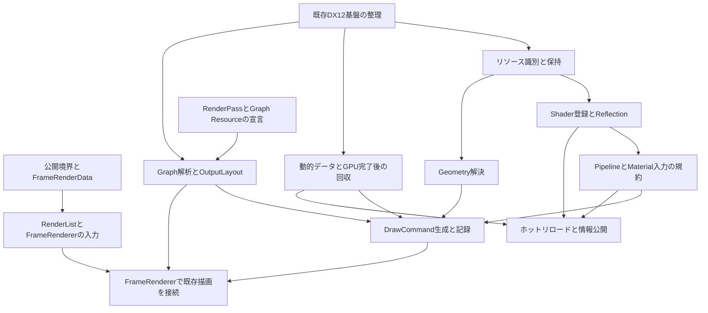

図14：矢印は機能を完成させるうえで必要な情報・機能の関係を示す。厳密な実装順を固定しない。宣言や検証の一部は、仮のリソースやテスト用の処理で先に確認できる。

例えば、Graphの依存解析は実際のMesh描画を完成させる前でも、使用宣言だけで試験できる。一方、統合した描画を安全に行うには、Geometry、Pipeline、入力、GPU領域の保持が揃う必要がある。このように「単体で着手できる条件」と「統合完了の条件」を分けて予定を作る。

### 12.4 既存実装から移すもの

第10章の調査記録を基に、実装計画時に次を再確認する。

| 会話で説明された既存箇所 | 目標とする移行・整理 | 作業の種類 |
|---|---|---|
| Scene・RenderSystemによる描画情報の生成 | Engine内部型からRenderer用FrameRenderDataへの変換 | 境界の整理 |
| AppによるShadow・Scene・PostProcess等の呼び分け | FrameRendererのPass構築 | 責務の移管 |
| ShaderLibraryの固定配列・列挙値 | ShaderHandleを用いた登録・参照 | 登録方式の置き換え |
| PSOKey・PipelineState | 論理Pipelineと出力条件の適合・PSO取得 | 再利用と再編 |
| Mesh・Sprite・UI等の個別描画 | Geometry解決と共通DrawCommand記録 | 共通化 |
| GpuTextureと内蔵RenderTargetの生成 | Graph Resourceとの対応づけ | 既存実体の再利用と接続 |
| 用途別のConstantBuffer | 共通入力の規約とフレーム単位の保持 | 入力設計と寿命管理 |
| Textureの転送待ち | 登録処理・転送・利用条件の整理 | 転送基盤への接続 |
| DescriptorHeapAllocator | 安全な更新・回収と容量の管理 | 既存機能の補強 |
| CommandContext・CommandQueue・FrameCommandManager | Graph記録、動的領域、旧実体の保持へ接続 | 既存機能の利用範囲拡張 |
| SwapChain | BackBufferのImportと最終用途指定 | 表示経路の接続 |

「旧コードを消す」「新しいクラスへ置き換える」こと自体を完了条件にしない。Renderer外部の知識が減ったか、宣言と実処理が対応するか、必要な寿命が守られるかを確認する。

### 12.5 スケジュールを決める前に揃える情報

作業日数と締切を決める前に、各実装単位について、現在のコードの位置、変更範囲、再利用できる部分、詳細設計が必要な事項、最小の動作確認方法を記録する。

本書の機能説明から自動的にすべての拡張をタスク化しない。特にノードツール、複数Queue、Aliasingなどの将来例は、今回の予定へ含めるという追加判断がない限り除く。

11月のフィードバック会について決まっているのは、この資料を自己学習と説明準備に使用することである。会の具体日、全機能の完成期限、提出物としての要件は本書では追加しない。

---

<a id="chapter-13"></a>
## 13. 詳細設計・動作確認・開発記録への引き継ぎ

### 13.1 詳細設計へ残す事項

以下は、記載不足を推測で埋めずに残した判断事項である。対応する機能へ着手する際に、本文の責務を維持したうえで決める。

| 番号 | 項目 | 決める内容 | 関係する章 |
|---|---|---|---|
| 1 | FrameRenderDataの所有 | コピー・移動・共有、提出後の変更可否、旧入力の保持 | 3・4・5 |
| 2 | APIの呼び出し規則 | 同時呼び出し、スレッド、再入、内部処理の時点 | 3・8 |
| 3 | 複数RenderView | 最終フィールド、共有リソース、各出力の所有と受け渡し | 4・5 |
| 4 | RenderObject | 最小共通フィールド、Bounds、描画属性 | 4・9 |
| 5 | Geometry Reference | 永続・動的Geometryの参照・登録方式、描画範囲 | 4・7・8 |
| 6 | UIの接続 | 頂点形式、描画順、Clip、Scissor、動的データの保持 | 4・7・10 |
| 7 | RenderList | 値・ポインタ・インデックス、元配列との対応、最大要素数 | 5 |
| 8 | RenderListの順序 | 透明描画などの比較条件、同値時の扱い、UI順序 | 5・7 |
| 9 | RenderPassBuilder | 公開メソッド、完成後の不変性、Pass種別、エラー型 | 5・6 |
| 10 | Callbackの寿命 | 値・移動・参照の使い分け、保存場所、Resultの扱い | 5・6 |
| 11 | Graph Resourceの識別 | Import重複、GraphをまたぐHandle、所有元の保持 | 6・10 |
| 12 | 初期内容の有効性 | 新規、Clear済み、履歴、外部からの内容の宣言 | 6 |
| 13 | 初期に対応するUsage | Stage、コピー、深度読み取り、併用、サブリソース | 6・10 |
| 14 | 診断と停止 | 警告・エラー、Object・Pass・Graphの停止範囲、回復表示 | 6・7 |
| 15 | Compile結果の保持 | 変更・失敗での無効化、実体との対応、解析状態の確定 | 6 |
| 16 | 描画先の記述 | 色の保存形式、Slot、深度、Viewport、MRT対応時期 | 6 |
| 17 | DrawCommand | 全フィールド、所有、配列の保持、GPU実体への参照方式 | 7・10 |
| 18 | Pipelineの内部モデル | 固定PSOか条件別解決か、生成・キャッシュ・Revision | 7・8 |
| 19 | Material Binding Policy | 各指定の意味、必須入力、不要入力、非互換時 | 7・9 |
| 20 | Shader登録 | パス・バイト列・Asset経由、成果物の所有、Stageの扱い | 8・11 |
| 21 | Reflectionの条件 | 成果物、利用API、取得できない情報、対応する型 | 9・11 |
| 22 | 共通Shader入力規約 | Buffer定義、Register、Root Signature、再Binding条件 | 9・10 |
| 23 | 共通Object入力 | Tint等の必要性と既定値、固定Layoutの範囲 | 4・9 |
| 24 | Materialの保存 | 論理値、名前ID、Layout別キャッシュ、Asset永続化 | 8・9 |
| 25 | Materialの既定値 | 供給元、未設定と未定義の区別、型変更時の処理 | 9・11 |
| 26 | Handleの詳細 | Generation、整数幅、無効値、依存参照、解放検出 | 8 |
| 27 | 更新処理の一貫性 | CompileからExecute中のMaterial・Shader更新、参照版 | 6・8・11 |
| 28 | ホットリロード | 失敗時、依存PSO切り替えの単位、旧実体の保持 | 11 |
| 29 | メタデータ公開 | 所有、参照寿命、JSON等の出力、更新中の扱い | 11 |
| 30 | 動的データの配置 | フレーム別領域、容量、共有、キャッシュ、超過時 | 10 |
| 31 | Descriptor | 容量、確保、更新、返却、GPU参照中の保持 | 10 |
| 32 | State・同期・回収 | 管理単位、記録と送信、Fence、未送信時、Resize | 6・10 |
| 33 | Graph外のリソース | 転送、読み取り状態、Usage収集との担当境界 | 6・8・10 |
| 34 | 実装計画 | 作業順、工数、機能ごとの完了条件、統合段階 | 12 |

Notionだけにある保存形式などの候補は、根拠があるため比較対象として残す。しかし、候補が記されているだけで確定へ変更しない。

### 13.2 設計意図を確認するための検証項目

この表は、合意した設計方針から整理した確認観点である。テスト実施済みの記録や、最終的な受入基準ではない。停止方法など未決定の挙動は、先に詳細設計してから期待結果を定める。

| 番号 | 確認対象 | 確認する内容 | 守りたい設計意図 |
|---|---|---|---|
| 1 | 公開境界 | Rendererを使う最小コードが、EngineのActorや描画Componentを必要としないか | Engine固有型からの独立 |
| 2 | リソース操作 | 登録・更新が所定APIを通り、外部でDX12実体を書き換えずに使えるか | 操作経路の集約 |
| 3 | Renderer入力 | 同じ型のFrameRenderDataから異なるViewを描画できるか | Viewの独立性 |
| 4 | Geometry解決 | MeshとUI由来のGeometryが、同じDrawCommand記録経路へ到達するか | Component分類からの分離 |
| 5 | RenderList | 異なる述語で任意の集合を作り、共通ヘルパーを変更せずに使えるか | パス構築の自由度 |
| 6 | Shadow選別 | Sceneの表示対象だけに影の生成対象が不当に限定されていないか | 用途に応じた選別 |
| 7 | 遅延Execute | Builder関数から戻った後も、Listと設定、元FrameDataが有効か | CPUデータの寿命 |
| 8 | Builder | 不完全なPassを登録可能な完成物として返さないか | 構築と登録の分離 |
| 9 | 登録順 | Compile後もPassの順序が変わらないか | 構築者の意図の維持 |
| 10 | 未生成内容 | 有効な初期内容がないRead／Loadを検出できるか | 使用宣言の検証 |
| 11 | 追記 | Loadでの追記を単純な不要上書きとして扱っていないか | 診断の正確さ |
| 12 | Compile失敗 | 古い計画や部分計画をExecuteしないか | 実行停止の安全性 |
| 13 | Usageと実処理 | PassやMaterialが使う管理対象が宣言に含まれるか | 解析の前提の維持 |
| 14 | Barrier | 深度書き込みから読み取りなどの遷移が実際の使用と一致するか | 状態管理の集約 |
| 15 | 描画先 | AttachmentsとOutputLayoutが実際のView形式へ対応するか | Pipelineと出力の適合 |
| 16 | Override順序 | Materialを置換した後にもPipeline Overrideが適用されるか | 一意な解決順序 |
| 17 | Material入力 | 同名・同型の値がOverride先のLayoutへ配置されるか | 論理値とGPU配置の分離 |
| 18 | 非互換入力 | 欠落や型不一致が、定めた規則で診断されるか | 暗黙の推測を避ける |
| 19 | DrawCommand配列 | 記録前に配列が作られ、必要な描画順が保たれるか | 変換と記録の分離 |
| 20 | 共通入力 | View／Lightの値選択がDrawSettingsへ戻っていないか | 入力供給の責務分離 |
| 21 | Bindingの有効範囲 | Root Signature等の変更後も必要な共通入力が有効か | 共通化とGPU仕様の整合 |
| 22 | GPU使用中の値 | 別フレーム・別View・別Objectの値で使用中領域を上書きしないか | 動的データの安全性 |
| 23 | リソース破棄 | 破棄要求があってもGPU利用完了まで実体を保持するか | 論理破棄と物理解放の分離 |
| 24 | Shader再読み込み | 同じHandleで更新し、依存PipelineとMaterialが新しい条件へ対応するか | 反復調整の基盤 |
| 25 | 更新失敗 | 未検証の新しい版や、解放済みの旧版を参照しないか | 更新処理の整合性 |
| 26 | Editor情報取得 | RendererがWidgetやUI注釈なしで必要な情報を公開できるか | Inspector非依存 |
| 27 | 実装範囲 | 未採用の拡張が説明用コードから必須機能へ混入していないか | 実装量の管理 |

性能に関する数値目標は決まっていない。必要に応じてCPU処理時間、GPU処理時間、Upload領域の使用量、DrawCommand数、Descriptor数を測定できるが、本書から未合意の数値を合格条件へ追加しない。

### 13.3 実装後に残す開発記録

各機能の実装後は、次の情報を本文の設計記録とは分けて追記する。

| 記録項目 | 書く内容 |
|---|---|
| 対象機能と設計判断 | 本書の章と付録Aの判断番号 |
| 実装した範囲 | 今回どこまで動くようにしたか |
| 詳細設計で選んだこと | 保存型、API、寿命、失敗時の処理など |
| 選択の根拠 | 比較した案と、採用理由 |
| 確認方法 | テスト入力、手順、利用したデバッグ機能 |
| 確認結果 | 成功・失敗、観測した内容、必要なら計測値 |
| 設計から変えた箇所 | 変更理由と影響する章 |
| 未解決事項 | 既知の制限と後続の作業 |
| 対象コミット | 確認したコードを特定できる情報 |

この表の項目は記録形式の提案であり、結果欄を推測で埋めない。「採用した設計」「実装した内容」「確認できた結果」を別々に書く。

### 13.4 作品フィードバック会に向けた説明の組み立て

説明では、機能名を列挙するだけでなく、次の関係を示す。

| 説明する順序 | 本書から取り出す情報 |
|---|---|
| 何を改善したかったか | 第1章の問題意識と設計目標 |
| 境界をどう変えたか | 第2・3章の変更前後と公開API |
| 具体的な描画がどう流れるか | 第5～7章の一つのPassとDrawCommandの例 |
| なぜその設計を選んだか | 各章の判断理由と付録A |
| 何を実装して確認できたか | 実装後の開発記録 |
| 何を今は行っていないか | 第12章の範囲と第13章の未決定事項 |

「拡張しやすい」「安全になった」「高速になった」という言葉だけで成果を説明しない。例えば、新しい対象集合を共通ヘルパーの変更なしで渡せた、未生成内容のReadを検出できた、異なるViewの値を独立に保持できた、といった確認結果へ結び付ける。結果がまだなければ、設計意図と今後の検証として説明する。

---

<a id="appendix-a"></a>
# 付録A. 設計判断の一覧と参照先

## A.1 設計判断の一覧

以下の番号は、先行資料「101Engine Renderer設計：このチャットでの決定事項と保留事項」のD01～D48との対応を維持している。判断の本文は各章に置き、この表はその参照先と理由の一覧とする。**最終整理に含まれる概念を、具体的なフィールドやアルゴリズムまで確定した仕様として扱わない。**

| 番号 | 判断 | 主な判断理由・制約 | 本文 | 根拠 |
|---|---|---|---|---|
| D01 | 主要なフレーム入力をFrameRenderDataへまとめる | Engineの内部構造と、Rendererの入力形式を分ける。リソース登録などの別APIは残る | [第2章](#chapter-02)、[第3章](#chapter-03) | C01、N01、N03 |
| D02 | 描画リソースをRenderer側で管理する | EngineはRendererの利用規約へ接続し、RendererからEngineの管理機能へ逆依存しない | [第2章](#chapter-02)、[第8章](#chapter-08) | C01、N03、N19 |
| D03 | 通常の公開APIへDX12実体やInspector仕様を要求しない | 他システムとの接続とEditor側の実装を分離する | [第2章](#chapter-02)、[第11章](#chapter-11) | C03、C04、N03、N16 |
| D04 | Initialize、SubmitFrameRenderData、Render、Finalizeを基本操作とする | 使用側が内部の各描画パスを直接操作しなくて済むようにする | [第3章](#chapter-03) | C01 |
| D05 | 登録要求の受付と内部処理時点を分ける | 実処理の時点をRendererが管理する。任意スレッド対応の保証とはしない | [第3章](#chapter-03)、[第8章](#chapter-08) | C01 |
| D06 | 描画構成を作る部分をFrameRendererと呼ぶ | RenderPassとの混同を避け、FrameRenderDataとの対応を明確にする | [第2章](#chapter-02)、[第5章](#chapter-05) | C13、C14 |
| D07 | 通常の利用者ではなくRenderer内部でPassを構築する | 描画パイプラインの構成を外部に要求しない | [第2章](#chapter-02)、[第5章](#chapter-05) | C05、N09 |
| D08 | Graphの宣言と計画を毎フレーム構築する | Viewや描画設定に応じて構成する。GPU実体の毎フレーム新規作成とは分ける | [第3章](#chapter-03)、[第6章](#chapter-06) | C05、C15 |
| D09 | RenderViewをFrameRenderDataに含める | 一つのカメラと出力先だけに固定しない | [第4章](#chapter-04) | C02、N06 |
| D10 | RenderObjectをComponent分類から独立させる | Engineの型を共通描画処理へ伝播させない | [第4章](#chapter-04) | C07、C08 |
| D11 | UIも共通のRenderObject経路へ接続する | UIの生成元と、最終的なGeometryの描画方法を分ける | [第4章](#chapter-04)、[第7章](#chapter-07) | C07、C08 |
| D12 | Geometry参照をMeshHandleだけに固定しない | 永続Meshと動的Geometryを、頂点・インデックス・Topology・範囲へ解決する | [第4章](#chapter-04)、[第7章](#chapter-07) | C08 |
| D13 | RenderListを用途非依存の集合にする | 固定のOpaque／Shadow等の構造を増やさず、構築の自由度を保つ | [第5章](#chapter-05) | C17、N09、N11 |
| D14 | BuildRenderListへ入力集合と条件式を渡す | 対象の選択条件をPass構築の近くに置き、ヘルパーを汎用化する | [第5章](#chapter-05) | C17、N11 |
| D15 | 対象選別を共通変換処理から外す | 誰を描くかと、渡された対象をどう変換するかを分ける | [第5章](#chapter-05)、[第7章](#chapter-07) | C11、N09 |
| D16 | RenderPassはUsageとExecuteを保持する | 管理機構が読む情報と、実際の描画処理を分ける | [第5章](#chapter-05)、[第6章](#chapter-06) | C05、C06 |
| D17 | BuilderへすべてのPass構築情報を渡す | 構築途中と完成済みを分け、AddPassを登録処理に限定する | [第5章](#chapter-05) | C18、N12 |
| D18 | Executeが必要な情報を呼び出し時まで保持する | 登録と実行が別の時点になるため | [第5章](#chapter-05)、[第10章](#chapter-10) | C05、C17、C18 |
| D19 | 登録順を維持し、自動並べ替えをしない | 構築者の順序を尊重し、誤りを勝手に修正しない | [第6章](#chapter-06) | C19、N08 |
| D20 | 依存情報を検証・診断・使用期間の把握へ使う | 並べ替えなくても、使用関係を管理する意義がある | [第6章](#chapter-06) | C19、N08 |
| D21 | 不適合を診断し、安全に実行できない処理を止める | 設定誤りを暗黙に実行しない。厳密な停止範囲は詳細設計へ残す | [第6章](#chapter-06)、[第13章](#chapter-13) | C19、N08 |
| D22 | CompileをCPU側の計画作成とする | 計画用の状態と、実際のGPU処理を混同しない | [第6章](#chapter-06) | C18、C19 |
| D23 | CompiledPassに実行準備の結果をまとめる | 宣言と実行時の準備結果を分ける | [第6章](#chapter-06) | C18、C19 |
| D24 | Graph Resourceを論理的な参照・記述とする | 必要条件の宣言を、物理リソースの生成方法へ直接固定しない | [第6章](#chapter-06)、[第10章](#chapter-10) | C05、C24 |
| D25 | Graphで使うものを一律にTransientとしない | BackBuffer、外部出力、履歴には別の所有者や利用期間がある | [第6章](#chapter-06)、[第10章](#chapter-10) | C24、N17 |
| D26 | 描画先設定・Clear／Load・バリアをExecute外で準備する | Usageと実際の準備処理を一致させる | [第6章](#chapter-06) | C06、C18 |
| D27 | 色と深度の出力記述を区別する | 出力方法自体の違いを表す。実コンテナの選択は別にする | [第6章](#chapter-06) | C18、N20 |
| D28 | MRTを設計で考慮し、今回の実装は必須にしない | Deferredへの拡張余地と初期実装量を分ける | [第6章](#chapter-06)、[第12章](#chapter-12) | C10、C11 |
| D29 | OutputLayoutを描画先の適合条件として扱う | 実際のTexture参照とは別にPSOの適合性を確認する | [第6章](#chapter-06)、[第7章](#chapter-07) | C19、N20 |
| D30 | 描画情報の解決と命令記録を共通化する | Passの事情を共通の最終描画処理へ持ち込まない | [第7章](#chapter-07) | C07、C08、C11 |
| D31 | DrawCommandを初期から配列化する | 配列を操作する最適化の有無にかかわらず、生成と記録を分けたいという判断 | [第7章](#chapter-07) | C08 |
| D32 | DrawCommandに解決済みの描画情報を持たせる | 最終記録段階でMaterialやMeshの意味を解釈し直さない | [第7章](#chapter-07) | C08、C18 |
| D33 | Objectごとの任意描画関数を中心APIにしない | 共通処理を単なるループの代替にせず、描画情報を検証できる形に保つ | [第7章](#chapter-07) | C07 |
| D34 | Material Overrideの後にPipeline Overrideを適用する | 両方を指定した際の優先順位を一意にする | [第7章](#chapter-07) | C10、N13 |
| D35 | Pipeline選択とMaterial入力の利用を分ける | Pipelineを変えてもOpacityなどの入力を元Materialから使う場合がある | [第7章](#chapter-07)、[第9章](#chapter-09) | C10、C18 |
| D36 | DrawSettingsを第二のPipeline Descriptionにしない | 同じ描画状態を二つの設定体系で重複管理しない | [第7章](#chapter-07) | C10、C11、N13 |
| D37 | 共通Frame／View／Light／Pass入力をDrawSettingsから分ける | Overrideの対象をRenderObjectの扱いに絞る | [第7章](#chapter-07)、[第9章](#chapter-09) | C20、C21 |
| D38 | コンパイル済みShaderを登録する | コンパイルはビルド側、登録・保持はRenderer側として分ける | [第8章](#chapter-08) | C03、N04 |
| D39 | Shader・Pipeline・Materialを分けて扱う | プログラム、描画状態、パラメータ値の責務と更新影響を分ける | [第8章](#chapter-08) | C03、N14 |
| D40 | 現段階ではScope注釈やコメント解析を導入しない | 全入力を動的に分類する汎用機構より、共通入力とMaterial固有入力の分離を優先する | [第9章](#chapter-09) | C20、C21、C22 |
| D41 | 最終的に選択したPipelineの要求からMaterial入力を解決する | 元Shaderのバッファ配置に依存せず、Override先に正しい値を渡す | [第9章](#chapter-09) | C19、C20、C21、N14 |
| D42 | 特殊入力を要求するOverrideは対応する対象と組み合わせる | PipelineOverride単体へ、存在しない情報の補完まで要求しない | [第7章](#chapter-07)、[第9章](#chapter-09) | C21 |
| D43 | ホットリロードでShaderHandleを維持する | 参照箇所をすべて付け替えず、更新版へ対応させる | [第11章](#chapter-11) | C04、N05 |
| D44 | Materialの値を論理名と型で引き継ぐ | Shaderの配置変更でMaterialの意味を失わない | [第9章](#chapter-09)、[第11章](#chapter-11) | C04、N14 |
| D45 | RendererのメタデータをEditorへ公開する | Inspector固有の表示方法をRendererに入れずに編集へ接続する | [第11章](#chapter-11) | C04、N16 |
| D46 | 値の構成とGPU参照領域への配置を分ける | Materialの意味と、物理メモリ管理を独立させる | [第9章](#chapter-09)、[第10章](#chapter-10) | C02、C18、C20、C21 |
| D47 | CPU側の記録用情報とGPU参照物の寿命を分ける | コマンド記録終了だけでGPUの使用完了とはならない | [第10章](#chapter-10) | C18、C24 |
| D48 | DX12基盤は既存部品を再利用して整理する | 新しい名称ごとに全面的な作り直しを行わず、責務と安全な利用条件を整える | [第10章](#chapter-10)、[第12章](#chapter-12) | C02、C24、N15 |

D27、D35、D39、D40、D46などには最終整理または具体形未確定の部分がある。表の一行だけで判断せず、該当章と第13章の留保を参照する。

## A.2 会話の参照箇所

引用は、このチャット内で該当発言を見つけるための短い抜粋である。会話そのものの時刻は、環境情報と混同しないよう番号の根拠に用いていない。記した利用者発言と、それに続く議論を対象とする。

| 参照 | 設計者の発言・該当箇所 | 主な記録対象 |
|---|---|---|
| <a id="c01"></a>C01 | 「自分の今の構想は、FrameRenderDataの受け渡しをランタイムのメインに据えることです。」 | 最初のRenderer境界、管理リソース、基本API、登録受付と内部処理の分離 |
| <a id="c02"></a>C02 | 「DX12のリソース群を適切にラップして運用したい」「RenderViewをFrameRenderDataに入れたい」「RenderGraphの形を最初から意識していきたい」 | 三つの採用方針 |
| <a id="c03"></a>C03 | 「ShaderLibraryのハードコードをやめ、ハンドル型に移行」「シェーダーのコンパイル自体を行うのはFrameWorkのCMakeLists」 | Shaderの登録・保持と、外部APIへDX12を要求しないこと |
| <a id="c04"></a>C04 | 「ホットリロードとエディタからのパラメータ変更」「インスペクタ仕様は絶対にRendererに持ち込つことはしません」 | Handleの維持、Reflection情報の取得、Editorとの分離 |
| <a id="c05"></a>C05 | 「追加されるPhase一つ一つがRenderGraph？」「登録するのはRenderer利用者？」 | PassとGraphの違い、構築・登録・実行の担当と時点 |
| <a id="c06"></a>C06 | 「RenderTargetの設定はExecuteの外ですか？Usageによって決定するからそう思った」 | Usageから行う準備とExecuteの責務 |
| <a id="c07"></a>C07 | 「MeshとかUIみたいな、描画アイテムについての情報を持たせてしまうのはやめた方がいい」「描画処理関数を渡すのはやりすぎでしたね」 | 共通描画処理に用途を固定しないこと、Objectごとの任意描画関数を中心にしないこと |
| <a id="c08"></a>C08 | 「VertexBuffer, IndexBuffer, Topology, Rangeで分けるのはいいですね」「この形で採用しましょう」「だったら先に配列化したい」 | Geometryの共通化、UIの接続、初期からDrawCommand配列を使う判断 |
| <a id="c10"></a>C10 | 「まず確実に上書き可能にしたいのは使うPipeline」「マテリアルそのもの自体も変えれたっていい」 | Override、Material入力、MRTの検討 |
| <a id="c11"></a>C11 | 「PassのExecuteに渡すRenderObject配列をすでにfilter済み」「Pass Settingsを第二のPipeline Description にしないという考え方はとても大事」 | 対象選別の位置、DrawSettingsの範囲、将来MRTへの意図 |
| <a id="c13"></a>C13 | 「RenderPathってRenderPassと音が似ているから分かりづらいね」から名称を比較した議論 | RenderPath、SceneRenderer、FrameRendererの役割と命名の比較 |
| <a id="c14"></a>C14 | 「FrameRendererいいね！FrameRenderDataとも対応するしね」 | FrameRendererの名称の採用 |
| <a id="c15"></a>C15 | 「ここでのRenderGraphは、Rendererの主要システム名としての呼称で、機能面でのRenderGraph, RenderPass, FrameRendererの総称とします」 | システム全体と個別機能の呼び分け |
| <a id="c17"></a>C17 | 「RenderListは個人的にstd::vector<RenderObject>の別名」「boolを返すラムダ」「パス構築の自由度が下がる気がする」 | 意味を固定しないRenderList、条件式を受け取る抽出、保存形式の候補 |
| <a id="c18"></a>C18 | 「Builder経由のみでの生成に限定」「NameやExecuteなどの他のすべての情報もそこに渡す」「BuildRenderCommandの中身」 | Builder、並べ替えの一時検討、Attachments、DrawSettings、Uploadの接続 |
| <a id="c19"></a>C19 | 「並べ替えはなくてもいいかも」「警告を出したり」「描画処理自体の実行をスキップ」 | 登録順を維持する最終方針、診断、OutputLayout、Material入力の照合 |
| <a id="c20"></a>C20 | 「スコープなくてもなんとかなる」「Executeでオーバーライトしたいのは、基本的にRenderObjectに対するオーバーライド」 | Frame／View／Light／Pass共通入力とDrawSettingsの分離 |
| <a id="c21"></a>C21 | 「全マテリアルに対して自動で設定される最低限のパラメータ」「余分なメモリを確保」「それはPipelineOverride単体の機能で解決すべきではないのかもしれない」 | 共通Object入力とMaterial固有入力の最終整理、Scope・コメント解析を今は導入しないこと、Overrideの責務範囲 |
| <a id="c22"></a>C22 | 「OK一旦ここまでにしましょう。これ以降の設計は各項目の実装時に詳細設計として考えます」 | 今回の基本設計の範囲と、詳細設計へ残す事項 |
| <a id="c24"></a>C24 | 「RenderGraph・Graph Resource・GPU Upload / Dynamic Data」「最新のリポジトリを参照用に添付」への分析と、後続の技術的な説明 | 論理・物理リソース、寿命、Upload、既存DX12機能に対する調査記録 |

C09、C12、C16、C23は先行資料で使用していない番号であり、資料や議論の欠落を意味しない。後続の資料作成依頼により、本書の用途、13章と付録の構成、推測で詳細を決めない方針が確認された。

## A.3 Notionに記録された意図と掲載箇所

参照元：[Notion「アーキテクチャ策定」](https://app.notion.com/p/3eddef1c864e8078af2ad12686bf3c76?source=copy_link)。ここでは取得した主本文の見出しで位置を示す。旧い説明や疑似コードをそのまま現行仕様へ移すのではなく、最終方針と整合する意図を残す。

| 参照 | 元の見出しと記述の要点 | 本書へ残す設計意図と留保 | 掲載箇所 |
|---|---|---|---|
| <a id="n01"></a>N01 | 冒頭。「エンジンがレンダラーの仕様に合わせた実装を行う」「どのようなシステムにも組み込むことができる形を目指す」 | Rendererの仕様を基準にする。移植性は目標であり、すべての環境で動作確認済みとはしない | 第1・2章 |
| <a id="n02"></a>N02 | Whole Architecture冒頭。「そのままクラス化するのではなく」「この単位ごとに実装タスクを細分化」。タスクのメモ「細かく考えすぎて時間をかけすぎないように」 | 機能単位で設計を整理し、具体的な型と作業量は実装時に詰める | 第1・12・13章 |
| <a id="n03"></a>N03 | Flow of Data。「このデータの形に合わせて、Renderer全体の機能を再設計」「所定のAPIからのみ変更可能」 | 入力境界を設計の基準とし、変更と情報公開の経路を管理する | 第2・3・8・11章 |
| <a id="n04"></a>N04 | Shader Resource。「ハードコード…から大きく改善」「Various Expressionに大きく寄与」 | 表現の追加と、固定Shader選択からの変更を関連づける。コンセプトの意味を記録以上に拡張しない | 第1・8・9章 |
| <a id="n05"></a>N05 | Shaderホットリロード。「マテリアルエディタの実装で必要不可欠」「Rapid Graphics Iteration」 | 描画結果を調整しながら開発する基盤として再読み込みを考慮する。Watcher・再コンパイルとRendererの責務は分ける | 第1・11章 |
| <a id="n06"></a>N06 | RenderView。「カメラ ↔ ターゲットの組み合わせを１フレーム内で実現」「エディタのビューポート」「監視カメラとそのモニター」 | 複数Viewを表現できる入力とする。挙げられた利用例をすべて今回の実装タスクへ変換しない | 第4章 |
| <a id="n07"></a>N07 | Render Preparation。「RenderSystemの責務をFrameRenderDataの構築のみに絞り」「Rendererに移す」 | Renderer固有の描画準備をRenderer内で管理する。これだけで画質や性能が保証されるとはしない | 第2・5・12章 |
| <a id="n08"></a>N08 | RenderGraph > 依存関係の解析。「並べ替えることはせず」「内部で勝手に変更されることを避け」「パイプライン構造への意識」 | 指定順を尊重し、検証・警告・停止を行う。ノードツールは将来の検討例 | 第6章、付録B |
| <a id="n09"></a>N09 | FrameRenderer、RenderListの構築。共通処理が固有Passを知ることや、FrameRenderDataに固定のListを持たせることへの懸念 | 汎用処理とPass固有処理を分ける。FrameRendererが利用するPass専用関数まで用途を知らない、とはしない | 第2・5・7章 |
| <a id="n10"></a>N10 | RenderList > データの持ち方。「コピーを量産するのは避けたい」「不用意にポインタにするのはあまり好かない」 | インデックス方式を候補とする理由を保存する。ただし保存形式とSubmit時のクリアは未決定 | 第5・10・13章 |
| <a id="n11"></a>N11 | BuildRenderList、SortRenderList。任意の走査対象と条件式、記述の分かりやすさ。Sortについて「std::sortでいいじゃん」 | 共通の抽出と必要な順序整理を分け、呼び出し側へ意味を置く。独自Sortラッパーの新設は必須にしない | 第5章 |
| <a id="n12"></a>N12 | RenderPassBuilder、AddPass。TypeMetadataと同様の専用Builder、生成後は変更せず再構築、「パス構築の責務を持たせない」 | Builderによる生成とGraphへの登録を分ける。既存TypeMetadataの実装を本書で再検証したとはしない | 第5・6章 |
| <a id="n13"></a>N13 | Executeの特殊設定。「第二のPipeline Descriptionにならないように」「overrideされたmaterialに対しても」 | Override対象を絞り、優先順位を明示する。SettingsはExecuteで保持する | 第7章 |
| <a id="n14"></a>N14 | Material周り、Pipelineのオーバーライド、どのようにパラメータを対応させるか。「論理的なParameter」「変数名・型」 | Shader・Pipeline・Materialの責務を分け、要求入力を論理値から解決する。MaterialとObjectの1対1制約は追加しない | 第8・9・11章 |
| <a id="n15"></a>N15 | DX12 Backend、Resource Wrapper。既存ラッパーの見直し、DX12直接操作の分散を減らす、「いつどのような状態であるべきかについては知るべきでない」 | リソース所有、使用判断、命令記録を分離する。全面的な作り直しや複数API対応を必須としない | 第10・12章 |
| <a id="n16"></a>N16 | Shader Metadata / Reflection、Editor Query / Metadata Access。「利用先の機能が責務を持ち」「情報…取得用API」 | メタデータ生成とUIでの解釈を分ける。JSONは保存・出力形式の候補 | 第2・9・11章 |
| <a id="n17"></a>N17 | Resources、Transient Resource Management。内部の寿命管理、デバッグでの保持、将来のHeapメモリ再利用 | 論理的な利用終了とGPU使用完了を分け、必要ならGraph外の利用まで保持する。生成Pass終了で破棄する旧説明は採用しない | 第6・10・12章 |
| <a id="n18"></a>N18 | Executeの特殊設定 > DeclareDrawResourceUsages。特殊設定によるリソース追加と、依存解析への反映 | 使用宣言が必要という意図を残し、対象を特殊設定だけに限定しない。宣言収集関数の形は詳細設計へ残す | 第5・6・7章 |
| <a id="n19"></a>N19 | Resources > Persistent Resources。Handleで破棄対象を指定し、「GPUの実行タイミングと被らないタイミングで破棄」 | 破棄要求と物理解放を分け、GPU使用完了を確認する | 第8・10・11章 |
| <a id="n20"></a>N20 | RenderTarget Binding、OutputLayout、RenderPassContext。「ラスタライズ出力そのものに関する分類」「書き込み先リソースの情報が必要」 | 出力方式に必要な区別を残し、PSOの適合条件を渡す。APIの差し替えや内部コンテナの形式は確定しない | 第6・7・10章 |

この表は設計者自身の思考を保存するためのものでもある。本文の修正によって誤った技術説明を除いた場合も、それを理由に対応する問題意識まで削除しない。一方、記録のない目的を後から設計者の動機として書き加えない。

## A.4 本書に取り込んだ資料と、その優先関係

| 資料 | 本書での用途 | 留意点 |
|---|---|---|
| このチャットの最終的な議論 | 設計方針の一次的な根拠 | 後の明示的な修正を優先する |
| Notion「アーキテクチャ策定」 | 設計者の考え、候補、機能分割の記録 | 過去の案と最新の本文が混在しているため、記述の新しさだけで採否を決めない |
| 先行資料 `01_101Engine_Renderer_Decisions.md` | 決定事項と保留事項の確認用一覧 | 会話の再整理であり、会話にない仕様を新たに決定する資料ではない |
| 先行資料 `02_101Engine_Notion_Review.md` | 旧記述、欠落、疑似コードの不一致を見落とさないための確認 | すべての指摘が誤りの指摘ではない。候補と詳細設計事項も含む |
| 付録Dの一次資料 | GPU API、C++、参考実装の技術上の条件を確認する | 外部実装の全機能を101Engineへ採用する根拠にはしない |

本書は単独で読めるように構成している。先行二資料を同時に読むことを、設計概要の理解に必須とはしない。Notion本文、旧ページ、埋め込み画像は変更していない。

---

<a id="appendix-b"></a>
# 付録B. 変更・不採用・延期した案

本文の方針と混ざらないよう、設計過程で比較した案をここへ分離する。**不採用は技術全体の否定ではなく、今回の目的と実装範囲に対する判断**である。

| 検討した案 | 最終的な扱い | 判断の経緯・理由 | 関連箇所 |
|---|---|---|---|
| RenderPathという名称 | FrameRendererへ変更 | RenderPassと音が似て区別しづらい | 第2・5章、C13・C14 |
| SceneRendererという名称 | FrameRendererを選択 | Renderer全体との差が分かりづらく、FrameRenderDataとの対応を重視した | 第2・5章、C14 |
| Opaque・Transparent・Shadow・UIを固定メンバーとして持つRenderLists | 採用しない | Pass追加のたびに固定構造を増やすことを避ける | 第5章、C17 |
| DrawSettingsやProcessRenderObjectsに用途別Filterを置く | Pass構築側で対象を選ぶ | 共通描画処理が各Passの目的を知りすぎないようにする | 第5・7章、C11 |
| Object一個の描画全体を任意コールバックへ渡す | 中心設計にしない | ループ以外の共通部分が失われ、描画情報が見えにくくなる | 第7章、C07 |
| RenderObjectを一つ解決するたび、直ちにDrawを記録する | 初期からDrawCommand配列を作る | 設計者が初期の配列化を希望した。最適化処理は後から追加可能 | 第7章、C08 |
| RenderObjectをMeshHandleだけで表す | Geometry参照へ一般化する | UIなどMesh Assetを経由しない頂点・インデックス情報も同じ描画経路に接続する | 第4章、C08 |
| AddPassがName、Setup、Executeを受けてPassまで構築する | Builderへ集約し、AddPassは完成したPassを受け取る | 構築と登録の責務を分け、記述を明確にする | 第5章、C18 |
| 依存解析後にトポロジカルソートで自動並べ替えする | 今回は採用しない | 登録順の意味を保ち、構築者へ診断を返す方針を選んだ | 第6章、C19 |
| 全Shader入力をScopeから供給元へ動的に振り分ける | 現段階では採用しない | Renderer共通入力、Object共通入力、Material固有入力の分離で必要範囲を扱う | 第9章、C20・C21 |
| HLSLコメントを解析して供給元を指定する | 現段階では導入しない | 便利さは認めつつ、解析・ビルド成果物との同期などの追加機能を今は必要としない | 第9章、C21 |
| 特定のspace番号を供給元Scopeとする固定規約 | 番号を確定しない | spaceの利用自体は否定しない。入力を識別する使用規約は詳細設計へ残す | 第9章、C21 |
| DrawSettingsにView・Light・Pass共通入力をすべて入れる | 共通入力の設定経路へ分離する | OverrideはRenderObjectの扱いに関する設定とする | 第7・9章、C20 |
| 全Materialへ共通パラメータを広く追加する | 最小限のObject共通入力とMaterial固有入力へ分ける | 万能なMaterial構造と不要な値を増やさない。具体的な共通項目は未決定 | 第9章、C21 |
| Blend・Depth・CullなどをDrawSettingsへ個別に複製する | Pipelineの選択で扱う | 第二のPipeline Descriptionにしない | 第7章、C10・C11 |
| 一つのMaterialと一つの描画対象を必ず1対1にする | その制約は採用していない | HandleによるMaterial参照から、共有禁止までは導けない | 第4・8章、N14 |
| Graph Resourceをすべて毎フレーム生成・破棄する物理リソースと考える | 論理参照と物理管理を分ける | Import、外部出力、履歴、後続Passによる利用を区別する必要がある | 第6・10章、C24 |
| Reflectionの内部・公開形式をJSONに固定する | 実装候補として残す | 必要なのはDX12非依存の情報取得であり、具体形式の合意はない | 第9・11章、N16 |
| SubmitFrameRenderData時に前回データを必ずクリアする | 条件付き候補として残す | 実行前のGraphやListが旧データを参照している可能性を、呼び出し規則で解消する必要がある | 第3・5・10章、N10 |
| MRT、Deferred Renderingを同時に完成させる | MRTの拡張性を設計し、今回の完成範囲は分ける | 将来の意図と今の実装量を混同しない | 第6・12章、C11 |
| Resource Aliasing | 将来の拡張として残す | 論理リソースと物理確保を分けておけば後から追加できる | 第10・12章、C24・N17 |
| 不要Passの自動除去 | 初期の必須機能としない | 診断と実際の処理削除は別の判断になる | 第6・12章 |
| 非同期Compute、複数Queue、並列コマンド記録 | 初期の必須機能としない | 使用宣言に基づく管理をまず成立させる | 第10・12章 |
| 外部向けPass構築API、ノード編集ツール | 将来の検討例として残す | 現時点の通常利用者はFrameRenderDataを提出する | 第2・12章、C05・C19 |

Pass順の自動並べ替えを採用しないことは、RenderListに必要な透明描画順の整理を禁止することではない。また、Object単位の任意描画関数を中心にしないことは、PassのExecuteをコールバックとして保持することの否定ではない。

---

<a id="appendix-c"></a>
# 付録C. 用語と疑似コードの読み方

## C.1 主要な用語

| 用語 | 本書での意味 |
|---|---|
| Renderer | 公開API、リソース管理、描画構成、命令記録、DX12基盤を含むシステム全体 |
| FrameRenderData | 一フレームの描画入力。RenderObject、RenderView、Light等をまとめる |
| FrameRenderer | 描画対象の集合、必要なリソース、Passの構成を決定して登録する機能 |
| RenderGraphシステム | 今回、FrameRenderer、RenderPass、機能としてのRenderGraphと関連描画処理をまとめて指す呼称 |
| RenderGraph Core | 機能としてのRenderGraphを総称と区別するための表記。必須クラス名ではない |
| RenderPass | 使用リソースと用途、および後から呼ぶ処理をまとめた単位 |
| RenderPassBuilder | Name、使用宣言、Executeなどを受け取り、完成したPassを生成する機能 |
| Resource Usage | どのリソースを、どのShader Stageから読むか、何の出力にするか等の使用宣言 |
| Execute | Passの場合はCPU側のコールバック。Graphの場合は、準備とコールバック呼び出しを制御する処理 |
| Compile | Graphの宣言を解析して実行計画を作る処理。HLSLのコンパイルとは別 |
| CompiledPass | Passを実行するために準備したバリア、描画先、Clear等を表す情報 |
| Graph Resource | Graph内でリソースを参照・記述する論理的な単位。GPU実体そのものではない |
| Create / Import | 必要なリソースの記述を作ること／既存リソースをGraph内へ取り込むこと |
| Attachment | ラスタライズの色・深度等の出力として接続するリソースと、その扱いの記述 |
| OutputLayout | 現在の出力数・Viewのフォーマット・サンプル条件等のPipeline適合情報 |
| RenderObject | EngineのComponent分類に依存しない描画対象の情報 |
| RenderList | 条件を満たすRenderObjectの集合。保存方式は未決定 |
| Geometry | 最終的に頂点・インデックス・Topology・描画範囲へ解決される形状情報 |
| Topology | 頂点を点、線、三角形等としてどのように組み立てるかの指定 |
| DrawSettings | Material／PipelineのOverrideとMaterial入力の扱いを指定する情報 |
| DrawCommand | 実際の描画命令を記録するために解決したPipeline、Geometry、Binding、定数参照等の情報 |
| Shader | コンパイル済みの描画プログラムと、その入力情報 |
| Pipeline | Shaderと描画状態の組み合わせを扱うRendererリソース。固定PSOか条件別の解決かは未決定 |
| Pipeline State Object（PSO） | DX12が使用するパイプライン状態の実体 |
| Material | 通常使用するPipeline、パラメータ値、Texture等の参照を扱うリソース |
| Binding | Shaderやコマンドが参照する入力と、実際のBufferやTexture等を対応づけること |
| Reflection | コンパイル済みShader等から、定数やリソースの名前・型・配置・Binding情報を取得する機能 |
| 定数バッファ | Shaderへ定数データを渡すBuffer。変数の配置とBuffer自体のアラインメントを区別する |
| Root Signature | DX12で、Shaderへ供給する入力の構成と設定先を記述するもの |
| Shader Stage | Vertex Shader、Pixel Shader、Compute Shaderなど、Shaderを実行する段階・種類 |
| Render Target View（RTV） | Textureを色の描画先として使うためのView |
| Depth Stencil View（DSV） | Textureを深度・ステンシルの描画先として使うためのView |
| Shader Resource View（SRV） | リソースをShaderから読み取るためのView |
| Unordered Access View（UAV） | Shaderから読み書きする用途などで使うView |
| Descriptor | リソースをどのように参照するかを記述するDX12側の情報 |
| Resource State | DX12上でのリソースの使用状態。登録のPending／Readyや内容の有効性とは異なる |
| Resource Barrier | リソースの使用状態やアクセス間の必要な同期を表す命令 |
| CommandList | GPUが行う処理をCPUから記録するコマンド一覧 |
| CommandQueue | 記録したコマンドをGPUへ送信する経路 |
| Fence | GPU処理の進行を確認し、再利用や解放の時点を判断する同期機能 |
| Dynamic Data | フレーム・View・Draw等で変わる値をGPU参照領域へ配置して保持する機能 |
| Upload領域 | CPUが用意した値をGPUから利用するためのメモリ領域 |
| Persistent Resource | 複数フレームにまたがって保持するリソース。永久保持の意味ではない |
| Transient Resource | Graph内の使用期間に応じて管理する一時リソース。CPU側の各Pass終了で破棄する意味ではない |
| Resource Aliasing | 適切な利用順序と切り替え管理の下で、異なるリソースに重なるメモリ領域を使わせること |
| Multiple Render Targets（MRT） | 一つの描画で複数の色出力先を使う方式 |
| G-buffer | Deferred Renderingで後段の照明計算に用いる、表面情報等の出力 |
| Deferred Rendering | 表面情報の出力と照明計算などを段階に分ける描画方式。今回のGraphそのものと同義ではない |
| ホットリロード | 実行中に更新されたリソースを再読み込みし、利用側へ反映する仕組み |
| Revision | 同じ論理リソースの内容更新を識別する情報 |
| Generation | 同じ保存位置を別リソースに再利用した場合等に、古いHandleを識別するための候補。採用形式は未決定 |

この用語表は本文を読むための説明であり、すべてを独立したクラスや公開APIとして作るという一覧ではない。

## C.2 疑似コードの解釈

本書の疑似コードは、最終仕様を勝手に埋めずに責務の接続を示すため、次の前提を持つ。

| 表現 | 解釈 |
|---|---|
| `Result<T>`、`TRY(...)` | エラーの存在を省略しないための表記。最終ライブラリや停止範囲の指定ではない |
| `RenderObjectIndex`を持つRenderList | Notionの保存候補を説明に使用したもの。値・参照方式を不採用にする決定ではない |
| `Build...()`、`Resolve...()` | その名前に対応する責務を示す。すべての関数分割が確定したとはしない |
| `MaterialBindingPolicy::RequiredOnly` | 選んだPipelineが必要とする入力を使う例。すべての列挙値と規則は詳細設計事項 |
| 一つのViewを使う描画例 | 複数Viewを禁止しない。共有Shadowや出力先の組み合わせは別の詳細設計 |
| Shadow・Scene・Bloom・Composite・UI | 責務や依存を説明する構成例。この全機能の新規実装を要求するリストではない |
| エラーを上位へ返す例 | 未検証のデータで描画を続けないことを示す。個別Objectをスキップする規則を最終決定したものではない |
| DrawCommandのGPU参照 | 参照先をGPU完了まで保持する必要がある。CPU配列が参照物をすべて所有する設計とは限らない |
| `SetViewData()`等 | 共通入力を準備する論理操作。Root Signatureの切り替え後に再Binding不要という保証ではない |

### C.3 混同しない区別

| 区別する対象 | 相違点 |
|---|---|
| Passの登録順／RenderListの描画順 | 前者はGraphの実行順として維持する。後者は透明描画などの必要条件に従って構築側が整理する |
| Resourceの存在／内容の有効性／Resource State | 実体があること、必要な画像が生成済みであること、適切な用途へ遷移していることは別 |
| BuilderのBuild／GraphのCompile／PassのExecute | Pass単体の完成、Graphの計画作成、命令記録処理の呼び出しは別の段階 |
| Binding情報／パラメータ値 | どこへ入力するかと、何を入力するかは別 |
| 定数のPacking／Upload領域の確保 | Shaderの配置に合わせて値を並べることと、完成データを置く場所の管理は別 |
| Register／Reload／Destroyの要求／内部の実処理 | APIの受付と、使用可能な時点・実体の差し替え・解放は必ずしも同時ではない |
| CPU側のコールバック終了／GPU完了 | 命令を記録し終えただけで、GPU参照物を破棄できるとは限らない |
| Pipeline Override／Material Override | 描画状態の選択を変えることと、値やリソース参照を含むMaterialを変えることは別 |
| 最小限の共通入力／すべての対象への無条件な適合 | 値の存在を保証しても、頂点形式やShaderの処理まで自動的に適合するわけではない |

---

<a id="appendix-d"></a>
# 付録D. 参考実装・技術資料

外部資料は実現方法と技術的な制約を確認するために用いた。**今回の設計を決めた根拠は会話とNotionであり、外部資料に実装されている機能のすべてを採用するわけではない。** 一次資料の説明を本文より優先して新しい設計要件を付け加えることもしない。

## D.1 会話中に参照した実装

<a id="r01"></a>
### R01　101Engineの既存実装に関する調査記録

- リポジトリ：[JuicyKebabs/101Engine](https://github.com/JuicyKebabs/101Engine)
- 会話中で調査対象として記録されたコミット：[`3229dfa8db2263c22df71d24a408986f6ff124ab`](https://github.com/JuicyKebabs/101Engine/tree/3229dfa8db2263c22df71d24a408986f6ff124ab)
- 本書での扱い：第10・12章の、既存機能と移行対象の参考情報。

当時の調査ではRenderer、GpuTexture、各Buffer、DescriptorHeapAllocator、CommandContext、CommandQueue、FrameCommandManager、SwapChain、RootSignature、PipelineStateなどが取り上げられた。Frame単位のコマンド再利用と、定数データの安全な再利用が別である点も検討された。

本書作成では、このコミットや最新ブランチのコードを改めて取得して実装検証していない。旧い調査結果を現在の不具合の断定や、未確認の変更済み機能の評価へ使わない。実装計画時には対象コミットを更新して差分を確認する。

<a id="r02"></a>
### R02　Delt06/dx12-rendererの比較から参考にした点

- リポジトリ：[Delt06/dx12-renderer](https://github.com/Delt06/dx12-renderer)
- 会話冒頭の解析対象として記録されたコミット：[`cefdfa84e9fc4bd4b2b325533e9f19d6a96eb272`](https://github.com/Delt06/dx12-renderer/tree/cefdfa84e9fc4bd4b2b325533e9f19d6a96eb272)

会話では、共通のDX12基盤、Material・Shader・Geometryの部品化、描画パスとリソース依存の宣言、Graph内リソースの使用期間管理などを参考にした。

一方、101EngineではFrameRenderDataを境界に置き、Engineの可変なScene状態をPassから直接参照する構成を前提としない。また、参考実装にある高度なリソース管理を、初期版の必須機能へそのまま移してはいない。これは会話中の比較の整理であり、本書作成時の再調査結果ではない。

## D.2 技術的な確認に用いた一次資料

以下は本書作成時に内容を確認した参照先である。文書の版やAPIの変更を、101Engineの設計変更として自動的に取り込まない。

| 参照 | 一次資料 | 本書で確認した内容 |
|---|---|---|
| <a id="t01"></a>T01 | Epic Games：[Render Dependency Graph](https://dev.epicgames.com/documentation/en-us/unreal-engine/render-dependency-graph-in-unreal-engine) | パスの宣言と遅延実行、リソース使用情報、内部・外部リソースの扱い |
| <a id="t02"></a>T02 | Epic Games：[Mesh Drawing Pipeline](https://dev.epicgames.com/documentation/en-us/unreal-engine/mesh-drawing-pipeline-in-unreal-engine) | 描画対象の情報を、Pass固有の処理を経て描画命令用の情報へ変換する構成 |
| <a id="t03"></a>T03 | Microsoft Learn：[D3D12_GRAPHICS_PIPELINE_STATE_DESC](https://learn.microsoft.com/en-us/windows/win32/api/d3d12/ns-d3d12-d3d12_graphics_pipeline_state_desc) | 頂点入力、Topologyの種類、色・深度形式、サンプル設定等のPSO条件 |
| <a id="t04"></a>T04 | Microsoft Learn：[Using a Root Signature](https://learn.microsoft.com/en-us/windows/win32/direct3d12/using-a-root-signature) | Root SignatureとBindingの有効範囲。PSO設定とRoot Signature設定の区別 |
| <a id="t05"></a>T05 | Microsoft Learn：[Using Resource Barriers to Synchronize Resource States in Direct3D 12](https://learn.microsoft.com/en-us/windows/win32/direct3d12/using-resource-barriers-to-synchronize-resource-states-in-direct3d-12) | Transition、UAV、Aliasingの区別とリソース状態の管理 |
| <a id="t06"></a>T06 | Microsoft Learn：[Fence-Based Resource Management](https://learn.microsoft.com/en-us/windows/win32/direct3d12/fence-based-resource-management) | GPU完了を基準にしたメモリ領域の回収 |
| <a id="t07"></a>T07 | Microsoft Learn：[Uploading Resources](https://learn.microsoft.com/en-us/windows/win32/direct3d12/uploading-resources) | Upload領域へのデータ配置と、必要に応じたGPUリソースへの転送 |
| <a id="t08"></a>T08 | Microsoft Learn：[Packing rules for constant variables](https://learn.microsoft.com/en-us/windows/win32/direct3dhlsl/dx-graphics-hlsl-packing-rules) | 定数、構造体、配列等のShader側の配置規則 |
| <a id="t09"></a>T09 | Microsoft Learn：[ID3D12GraphicsCommandList::OMSetRenderTargets](https://learn.microsoft.com/en-us/windows/win32/api/d3d12/nf-d3d12-id3d12graphicscommandlist-omsetrendertargets) | 色出力の配列と深度・ステンシル出力が別の指定であること |
| <a id="t10"></a>T10 | Microsoft Learn：[ID3D12ShaderReflection](https://learn.microsoft.com/en-us/windows/win32/api/d3d12shader/nn-d3d12shader-id3d12shaderreflection) | Shaderの定数バッファや入力・リソース情報を調べるAPI |
| <a id="t11"></a>T11 | Microsoft Learn：[D3D12_SHADER_VARIABLE_DESC](https://learn.microsoft.com/en-us/windows/win32/api/d3d12shader/ns-d3d12shader-d3d12_shader_variable_desc) | 変数名、定数バッファ内のStartOffset、Size等 |
| <a id="t12"></a>T12 | Microsoft Learn：[D3D12_SHADER_INPUT_BIND_DESC](https://learn.microsoft.com/en-us/windows/win32/api/d3d12shader/ns-d3d12shader-d3d12_shader_input_bind_desc) | リソースの名前、種類、Binding番号、Space等 |
| <a id="t13"></a>T13 | Microsoft Learn：[IDxcUtils::CreateReflection](https://learn.microsoft.com/en-us/windows/win32/api/dxcapi/nf-dxcapi-idxcutils-createreflection) | シリアライズされたShader／Reflection情報からのReflection取得 |
| <a id="t14"></a>T14 | C++ working draft：[Lambda captures](https://eel.is/c++draft/expr.prim.lambda.capture) | 値・参照・初期化キャプチャと寿命の関係 |
| <a id="t15"></a>T15 | Microsoft Learn：[Resource binding in HLSL](https://learn.microsoft.com/en-us/windows/win32/direct3d12/resource-binding-in-hlsl) | レジスタ番号と論理的なレジスタ空間の意味 |
| <a id="t16"></a>T16 | Microsoft Learn：[Constants](https://learn.microsoft.com/en-us/windows/win32/direct3d12/constants) | 定数バッファ配置の256バイトのアラインメント定数 |
| <a id="t17"></a>T17 | Microsoft Learn：[ID3D12Device::CreatePlacedResource](https://learn.microsoft.com/en-us/windows/win32/api/d3d12/nf-d3d12-id3d12device-createplacedresource) | Heap上へのResource配置と、重なる領域を利用する際の条件 |
| <a id="t18"></a>T18 | Microsoft DirectX Specifications：[Resource Binding](https://microsoft.github.io/DirectX-Specs/d3d/ResourceBinding.html) | Shader-visible Descriptorと、RTV／DSVの利用・保持条件の違い |
| <a id="t19"></a>T19 | Microsoft DirectXShaderCompiler：[HLSLOptions.td](https://github.com/microsoft/DirectXShaderCompiler/blob/main/include/dxc/Support/HLSLOptions.td) | `-Fre`によるReflection出力、`-Qstrip_reflect`による除去の指定 |

### D.3 UEから採用した考え方と、採用を限定した範囲

| 参考にした考え方 | 101Engineでの扱い |
|---|---|
| Passが使用するリソースと実行する処理を別に宣言する | UsageとExecuteとして採用する |
| 宣言を集めてからCPU側でコマンドを記録する | Builderによる構築、GraphのCompile、Executeへ分ける |
| 中間リソースを論理的に記述する | Graph ResourceをGPU実体から分ける |
| 描画対象の情報と最終Draw用情報を分ける | RenderObject、DrawSettings、DrawCommandの段階へ整理する |
| Pass固有処理から共通の命令記録へ接続する | 共通RenderObject経路を用い、Fullscreen等は別の描画処理も許容する |
| 高度なパス・メモリ管理 | 初期からUE全体を再現しない。自動並べ替え、不要Pass除去、Aliasing等は本文の採用範囲に従う |

UEの型やマクロを、そのまま101Engineの必須APIにしない。参考にした技術の名前が同じでも、管理する範囲、前提、所有方法まで同じとはしていない。[T01](#t01)、[T02](#t02)

---

## 文書の更新について

実装時に詳細設計した内容は、該当章の「未決定」を更新し、判断の根拠と対象コミットを第13章の記録へ追加する。変更が従来の方針と異なる場合は、本文と付録Bの扱いを同時に整理する。

この文書を次のチャットへ引き継ぐ際は、本文の採用方針、第12章の実装範囲、第13章の未決定事項を基準とする。付録に保存した旧案や、疑似コードの説明用の型を、確認なしに現在の仕様へ戻さない。
